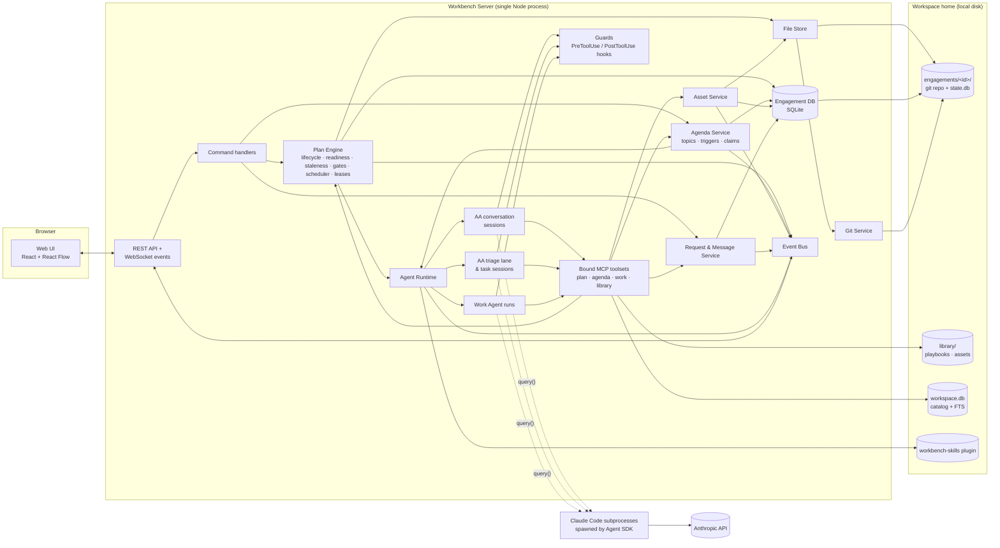
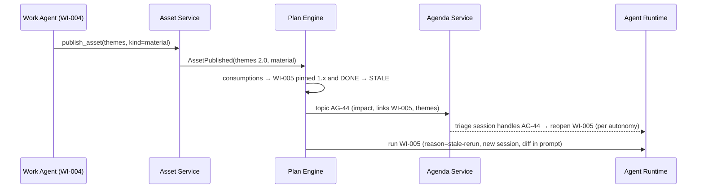

# Agentic Project Workbench — Architecture (POC)

| | |
|---|---|
| **Status** | Draft v2: review feedback on the open architecture questions applied (see §20) |
| **Date** | 2026-09-23 |
| **Companion** | [DESIGN.md](DESIGN.md): the functional design. Section references like "D§5.2" point there. |
| **Scope** | Technical architecture for a local, single-user POC on the Claude Agent SDK |

---

## 1. Architectural Drivers

| Driver | Consequence |
|---|---|
| **Local, single-user demo** | A single Node process, no database *server*, no auth. Everything runs on the laptop. |
| **Transparency** (D§2.1-9) | Content and definitions are readable files, and every engagement is a Git repository. State that is relational or transactional goes into an embedded SQLite database, with readable projections. |
| **Locus of control** (D§2.1-2) | Enforcement happens in several independent layers (§8.5). Agents write only inside their own item. Everything else is written *by the server on their behalf*, through validated tools. |
| **Approach/execution split** | The Approach Agent and the Work Agents run as **separate SDK sessions** with different tools, working directories and permissions. |
| **Inputs that don't arrive one at a time** | Human requests, agent questions, proposals and events arrive concurrently and out of order. The Approach Agent therefore works from a **stateful agenda** of open topics, not from one serial conversation (§8.1). |
| **Deterministic rules, intelligent choices** | Readiness, staleness, versioning, gates, leases and the lifecycle are enforced by deterministic code (the **Plan Engine**). LLM agents decide *what* to do, and code enforces *what is allowed*. |
| **Experimentation** (D§1, D§8.1) | Behaviour is driven by settings, model profiles and prompt files that can be changed without code changes. |
| **Robustness to restarts** | All state is on disk. Sessions can be resumed, or rebuilt from state. |
| **No parallel instances of a session** | Any SDK session is active in at most one place at a time. This is enforced with leases (§8.4), in the POC and later in the multi-user version. |
| **Windows host** | Path normalization, Git for Windows, process limits (§15). |

---

## 2. Key Decisions (summary)

| # | Decision | Rationale |
|---|---|---|
| A1 | **TypeScript end to end** (Node 26 server and React UI) | One language and shared Zod schemas across UI, server and agent tools. The Agent SDK has a first-class TypeScript version. |
| A2 | **Claude Agent SDK** (`@anthropic-ai/claude-agent-sdk`) as the agent runtime | It provides built-in file tools, sessions and resume, hooks, permission rules, in-process MCP tools, skills and plugins, and subagents. It runs locally. |
| A3 | **The Approach Agent is a role with shared state, not one conversation.** It runs as several short or medium SDK sessions: *conversation* sessions (led by the human), a *triage* lane (led by the system) and *task* sessions. All of them work from the same plan, **agenda** and decision log. | This handles inputs that don't arrive one at a time, follows the human's priorities, keeps contexts small (which matters on smaller models), and survives lost sessions. |
| A4 | **Work Agents run as one SDK session per work item run** | Independent lifecycles, working directories, permissions and resume per item. |
| A5 | **Hybrid storage.** Files (in Git) hold content and definitions. **SQLite** holds relational and transactional state: requests, agenda, proposals, runs, versions, consumption, events, leases. | Requests between agents, agenda topics and consumption links are naturally relational, with queries, constraints and transactions. It is still a single local file with no server. |
| A6 | **One Git repository per engagement, with flat per-item folders.** No worktrees. | Per-folder history. Sessions never run in parallel on the same item, so isolation through worktrees isn't needed. |
| A7 | **Server-owned publishing**: agents write drafts to their `work/` folder, and a `publish_asset` tool makes the immutable version | This enforces single-writer, immutability and versioning in code, not in prompts. |
| A8 | **Custom tools are in-process MCP servers, bound per session** | The handler closes over the actor's identity, so an agent *cannot* act as someone else. |
| A9 | **Skills are packaged as a local plugin** and selected per run | Versioned with the app, and chosen per run. |
| A10 | **A blocking question ends the run, and the answer resumes the session** | It survives restarts and waits of hours or days. |
| A11 | **A workspace library with a searchable catalog** (SQLite FTS5) for playbooks and, later, workspace-scope assets | Discoverability across engagements (D§5.3, D§6.4). |
| A12 | **React + React Flow + ELK** for the BPMN-lite canvas | Custom nodes, compound nodes, and automatic layout with collapse/expand. |
| A13 | **Model profiles.** The `test` profile (the default) uses **`claude-haiku-4-5`** for every role. The `demo` profile uses a stronger model. | Low-cost, fast iteration during development, and one switch for demos. |

---

## 3. System Overview



| Component | Responsibility |
|---|---|
| **REST API / WebSocket** | Commands in, events out. There is no business logic here. |
| **Command handlers** | Validate human commands and call the engine and services. |
| **Plan Engine** | The deterministic core. It owns the item state machine, readiness and staleness, validation and application of plan operations (with optimistic concurrency), gates, the run scheduler and **session leases**. It never calls an LLM. |
| **Agenda Service** | The Approach Agent's stateful memory of open topics (§8.1). It creates topics from events, evaluates triggers, manages claims and priorities, and feeds the triage lane. |
| **Agent Runtime** | Starts, streams, interrupts and resumes SDK sessions. It builds prompts, briefings and context packs, and wires up toolsets, guards, skills and models. |
| **Bound MCP toolsets** | Agent-callable tools (§8.6), bound to one actor and session. |
| **Guards** | SDK hooks that enforce write and read scope, record implicit reads and audit tool use (including tool use inside subagents). |
| **Asset Service** | Publishing, version numbering, scope checks, pinning, diffs, reclassification and full-text indexing. |
| **Request & Message Service** | Typed requests between actors (questions, change requests, proposals, gate requests), their threads and their state. The Inbox is a query over these. |
| **File Store** | Reads and writes Markdown/YAML content and definitions. Serializes writes. Watches for manual edits. |
| **Engagement DB** | SQLite, one file per engagement (`.workbench/state.db`). Schema in §6.2. |
| **Workspace DB** | SQLite at workspace level: the library catalog plus the FTS5 search index (§10.3). |
| **Git Service** | Checkpoint commits (files, projections and a DB snapshot) with actor attribution, and tags. |
| **Event Bus** | Typed in-process pub/sub. It persists events to the DB and fans them out to the UI and the Agenda Service. |

---

## 4. Technology Stack

| Concern | Choice |
|---|---|
| Runtime | Node.js 26 (validated in the M0 spike; no native-module blockers), TypeScript (strict), pnpm workspaces |
| Agent runtime | `@anthropic-ai/claude-agent-sdk` (TypeScript), pinned to `0.3.280` (bundles Claude Code 2.1.280) |
| Models | Profiles in `workbench.config.yaml`. The **default `test` profile uses `claude-haiku-4-5` for all roles.** The `demo` profile (for example `claude-opus-5`) is switched on explicitly. |
| Server | Fastify + `@fastify/websocket` |
| Schemas | Zod, shared by the API, domain, DB layer and MCP tool definitions |
| Database | SQLite through **`better-sqlite3@^13`** (synchronous; N-API prebuilds, so it installs on Node 26 without a compiler. v11 does not build on Node 26.) Drizzle ORM for the typed schema and migrations, FTS5 for search. Fallback: built-in `node:sqlite` through `drizzle-orm/sqlite-proxy`. |
| Files | `gray-matter` (front-matter), `yaml`, `chokidar` (watching manual edits) |
| Git | Git CLI through `simple-git` |
| UI | React 19 + Vite, `@xyflow/react`, `elkjs`, TanStack Query, Zustand |
| Markdown | `react-markdown` + `remark-gfm`, `jsdiff` |
| Document skills | Scripts bundled in skills. Python 3 (3.14 validated): `markitdown` for extraction, `python-pptx` for PPTX export, Markdown → HTML → Edge headless `--print-to-pdf` for PDF export |
| Testing | Vitest (engine, DB, store), Playwright (UI smoke tests), fake-agent replays |
| Auth | `ANTHROPIC_API_KEY` environment variable |

Example `workbench.config.yaml`:

```yaml
profile: test                     # test | demo
profiles:
  test:
    models: { approach: claude-haiku-4-5, work: claude-haiku-4-5, assist: claude-haiku-4-5 }
    limits: { maxTurnsPerRun: 40, maxConcurrentRuns: 3 }
  demo:
    models: { approach: claude-opus-5, work: claude-opus-5, assist: claude-opus-5 }
    limits: { maxTurnsPerRun: 80, maxConcurrentRuns: 3 }
```

Haiku 4.5 has a smaller context window (200K) and less planning depth than the larger models. That's acceptable for testing, and the agenda-based Approach Agent design (short sessions with briefings) is meant to work within it. Quality judgements about agent behaviour should be made on the `demo` profile.

---

## 5. Storage Layout

### 5.1 Workspace home

```
<workbench-home>/                       # configurable; default ./workspace in the repo (git-ignored)
├── workbench.config.yaml
├── workspace.db                        # library catalog + FTS5 index (§10.3)
├── library/
│   ├── playbooks/
│   │   └── it-strategy/                # playbook.md, plan.template.yaml, defaults.yaml, examples/
│   └── assets/                         # workspace-scope assets (later): <entry-id>/v1.0.md …
└── engagements/
    └── acme-it-strategy/               # ← one Git repository per engagement
```

### 5.2 Engagement repository

```
acme-it-strategy/
├── engagement.yaml                     # name, settings, plan version
├── plan.md                             # PROJECTION: readable plan tree with statuses
├── agenda.md                           # PROJECTION: open Approach Agent topics
├── items/
│   ├── ENG/                            # the engagement as root item: context, stakeholders, decisions, intake
│   │   ├── item.md
│   │   ├── work/                       # Approach Agent drafts, including approach-journal.md
│   │   └── assets/<slot>/v1.0.md …
│   ├── PH-1/item.md                    # composite: definition only
│   ├── WI-004/
│   │   ├── item.md                     # DEFINITION: front-matter + brief
│   │   ├── worklog.md                  # append-only (server-written through a tool)
│   │   ├── work/                       # LOCAL scope: the only place the Work Agent writes
│   │   └── assets/themes/
│   │       ├── asset.yaml              # PROJECTION of the version registry
│   │       ├── v1.0.md  v1.1.md  v2.0.md   # immutable content
│   └── …
├── decisions/D-003.md                  # decision records (content; indexed in the DB)
└── .workbench/
    ├── state.db                        # SQLite: state and relations (committed at checkpoints)
    └── runs/R-0042.jsonl               # per-run streams (git-ignored, large)
```

### 5.3 What lives where

| Kind | Where | Examples |
|---|---|---|
| **Content** (for people to read) | Files | Briefs, worklogs, asset versions, decision records, playbooks, approach journal |
| **Definitions** (for people to edit) | Files (`item.md` front-matter), indexed in the DB | Inputs, outputs, skills, gate, acceptance criteria, parent |
| **State and relations** | SQLite | Item status, runs, requests, messages, agenda, proposals, version registry, consumption and pins, implicit reads, gate verdicts, events, leases |
| **Projections** (for people to read) | Generated files, committed | `plan.md`, `agenda.md`, `asset.yaml` |

**Rules:**

- The DB index of file definitions can always be rebuilt from the files.
- State is never kept in files except as a projection.
- The server updates a file and its DB state in one operation: file write first, then the DB transaction. If that fails, a startup reconciliation fixes it.
- **Checkpoint commits** (§11) run `PRAGMA wal_checkpoint(TRUNCATE)`, write the projections, and commit the files plus `state.db`. A Git tag therefore captures the *complete* state, and demo checkpoints restore exactly.

---

## 6. Domain Model and Database Schema

### 6.1 Core types (abridged; Zod in `packages/core`)

```ts
type ItemId = string;                                   // "WI-004", "PH-1", "ENG"
type Actor = "human" | `approach:${SessionId}` | `agent:${ItemId}` | "system";
type ItemStatus = "draft" | "waiting" | "ready" | "in_progress" | "blocked"
                | "at_gate" | "done" | "stale" | "cancelled";

interface WorkItemDef {                                 // from item.md
  id: ItemId; title: string; parent: ItemId | null; order: number;
  executor: "agent" | "human" | null;                   // null = composite
  brief: string; acceptance: string[];
  inputs: { slot: SlotRef; required: boolean; pin?: string }[];
  sequencing: ItemId[];
  outputs: { slot: string; format: string; scope: "local" | "project"; description: string }[];
  skills: string[]; gate: GateStep[]; autostart: boolean;
  multiInstance?: { over: SlotRef };
}

type RequestType = "question" | "blocker" | "proposal" | "change_request" | "gate_request";
interface Request {                                     // the requests between agents
  id: string; type: RequestType; from: Actor; to: Actor | "approach"; item?: ItemId;
  status: "open" | "claimed" | "answered" | "escalated" | "withdrawn" | "closed";
  payload: QuestionPayload | ProposalPayload | ChangeRequestPayload | GatePayload;
  response?: { mode?: "approve" | "amend" | "replace" | "discuss"; text: string; by: Actor };
  blocking: boolean; agendaId?: string; threadId?: string;
}
interface QuestionPayload { question: string; hypothesis: string; alternatives?: string[] }

type AgendaKind = "question" | "proposal" | "decision" | "review" | "impact"
                | "request" | "follow_up" | "risk" | "run_issue";
interface AgendaItem {                                  // the Approach Agent's open topics (§8.1)
  id: string; kind: AgendaKind; title: string; summary: string;
  status: "open" | "in_progress" | "waiting" | "closed" | "dropped";
  owner: "approach" | "human";
  priority: 1 | 2 | 3; humanRank?: number;              // the human's ordering overrides priority
  trigger?: Trigger;                                    // re-opens the topic when met
  claim?: { session: SessionId; until: string };
  links: { items?: ItemId[]; requests?: string[]; proposals?: string[]; assets?: SlotRef[] };
  resolution?: string;
}
type Trigger =
  | { on: "asset_published"; slot: SlotRef; kind?: "material" }
  | { on: "item_status"; item: ItemId; status: ItemStatus }
  | { on: "request_resolved"; request: string }
  | { on: "time"; at: string };
```

### 6.2 SQLite schema (engagement DB, abridged)

| Table | Key columns | Notes |
|---|---|---|
| `items` | `id` PK, `parent`, `ord`, `executor`, `status`, `autostart`, `def_hash`, `last_session_id` | Definition columns are an index of `item.md`. `status` is authoritative here. |
| `item_inputs` / `item_outputs` | `item_id`, `slot_ref`, `required`, `pin` / `slot`, `format`, `scope` | Readiness and graph queries |
| `asset_versions` | (`slot_ref`, `major`, `minor`) PK, `kind`, `author`, `at`, `note`, `run_id`, `path` | Version registry |
| `consumptions` | `run_id`, `slot_ref`, `major`, `minor`, `mode` (`declared`/`implicit`/`library`) | Pins and implicit reads. Staleness queries run on this table. |
| `runs` | `id` PK, `item_id`, `session_id`, `reason`, `outcome`, `cost_usd`, `turns`, `prompt_hash`, `model`, `started_at`, `ended_at` | |
| `requests` | `id` PK, `type`, `from_actor`, `to_actor`, `item_id`, `status`, `blocking`, `payload` JSON, `response` JSON, `agenda_id`, `thread_id`, timestamps | **The requests between agents** |
| `threads` / `messages` | `thread.id`, `subject`, `agenda_id` / `msg.id`, `thread_id`, `actor`, `body`, `at` | Conversations: human ↔ AA, discussions |
| `agenda_items` | `id` PK, `kind`, `status`, `owner`, `priority`, `human_rank`, `trigger` JSON, `claim_session`, `claim_until`, `resolution` | |
| `agenda_links` | `agenda_id`, `target_type`, `target_id` | Links to items, requests, proposals, assets |
| `proposals` | `id` PK, `origin`, `status`, `base_plan_version`, `rationale`, `ops` JSON, `applied_plan_version` | Optimistic concurrency (§7.4) |
| `gate_steps` | `item_id`, `seq`, `type`, `status`, `verdict`, `by`, `asset_versions` JSON, `decision_id` | |
| `decisions` | `id` PK, `forum`, `date`, `outcome`, `path`, `endorsed_versions` JSON | The content is in `decisions/*.md` |
| `sessions` | `session_id` PK, `role` (`aa-conversation`/`aa-triage`/`aa-task`/`work`), `scope_key`, `lease_holder`, `lease_until`, `status` | Leases (§8.4) |
| `events` | `seq` PK, `type`, `actor`, `payload` JSON, `at` | Timeline, replay, triggers |
| `asset_fts` | FTS5(`slot_ref`, `title`, `body`) | `search_assets` |

---

## 7. Plan Engine (the deterministic core)

### 7.1 State machine

The engine owns every status transition (D§4.2). Agents and humans *request* transitions through tools and commands, and the engine validates each one. For example, `submit_outputs` is only accepted while the item is `in_progress` and all of its required output slots are published.

### 7.2 Readiness

An item becomes `ready` when:

1. its status is `waiting` and it has an executor;
2. every required input slot has a published version (for a wildcard slot, the producing composite is `done`, or every expected child slot is published);
3. every `sequencing` item is `done`.

Readiness is recomputed incrementally, as SQL queries over `item_inputs`, `asset_versions` and `items`, triggered by events.

### 7.3 Staleness and version effects

When `AssetPublished { slot, v, kind }` arrives:

- **minor**: consumers get a notification. No status changes.
- **material**: every `done` consumer whose latest run pinned an older major version (a query on `consumptions`) becomes `stale`. Endorsements of older majors are marked outdated. An **`impact` agenda topic** is created for the Approach Agent.
- Propagation is not transitive (see D§5.2). Reclassification replays the rule for that version.

### 7.4 Plan operations with optimistic concurrency

Several Approach Agent sessions can be active at once (§8.1), so every proposal carries `base_plan_version`. When a proposal is applied:

1. **Validate** against the *current* plan: IDs, no cycles, slot integrity, and handling of running items. If the plan version has moved since `base_plan_version`, the ops are re-validated against the new plan. The proposal is **rejected as a conflict** if any op touches an item that changed in between. The proposing session gets the conflict details and re-plans.
2. **Apply**: write the `item.md` files, update the DB index, and bump the plan version.
3. **Record**: an event, a checkpoint commit and a `plan/vN` tag.
4. **Recompute** readiness.

The autonomy rules (D§8.1) decide whether a proposal is applied automatically or waits for approval.

### 7.5 Gates

`submit_outputs` moves the item to `at_gate` and starts the gate chain:

- **ai-review** creates a `review` agenda topic. It is handled by the **Approach Agent** in a task session with the review prompt (§8.1), which calls `review_item`.
- **human-review / endorsement** creates a gate request in the Inbox. An endorsement verdict produces a decision record (`decisions/D-xxx.md`, plus a `decisions` row, plus a minor version of `ENG/decisions`).
- **changes requested** resumes the Work Agent session with the feedback.
- When the last gate in the chain passes, the item becomes `done`.

### 7.6 Scheduler

- Items that become `ready` with `autostart` are queued in plan order.
- A concurrency limit applies to Work Agent runs (default 3). The triage lane is a separate lane with one session at a time (§8.1).
- **Pause** stops dequeuing and interrupts active runs (`query.interrupt()`), keeping their sessions for resume.

---

## 8. Agent Runtime

### 8.1 Approach Agent: a role with an agenda, not one conversation

**Problem.** The Approach Agent receives input from many directions at once: the human (who may jump between topics), Work Agent questions and proposals, gate reviews, and impact notices. A single serial conversation forces all of this into one order, lets the context grow without limit, and makes the agent's priorities follow arrival order rather than the human's.

**Design.** The Approach Agent's continuity lives in **shared state**, not in a conversation:

| State | Purpose |
|---|---|
| **Plan** (items, statuses, versions) | What exists and where it stands |
| **Agenda** (`agenda_items`) | **Open loops**: everything the Approach Agent needs to handle, follow up on or bring to the human |
| **Decision log** | Closed loops: what was decided, by whom, and why |
| **Approach journal** (`ENG/work/approach-journal.md`) | Narrative memory: working hypotheses about the client, rationale for the approach, lessons learned |
| **Requests and threads** | The detail behind each topic |

Several kinds of SDK sessions all use the same role prompt and tools:

| Session kind | Started by | Scope | Lifetime |
|---|---|---|---|
| **Conversation** | The human: a general chat, or "discuss" on an agenda topic or Inbox item | One thread, following the human's priorities | Medium. Resumable per thread. |
| **Triage** | The Agenda Service, when there are open topics owned by the Approach Agent | **One topic** (or a small batch of related topics) per session, in priority order | Short, then closed |
| **Task** | The engine or a topic: AI review, playbook capture, initial planning | One task | Short or medium |

**Agenda mechanics:**

- **Topics are created** deterministically by the engine for system events: a question routed to the Approach Agent, a Work Agent proposal, an AI-review gate, a material impact, or a failed run. They are also created by the Approach Agent through `agenda_add` (for example a commitment such as "re-check initiatives when the CFO notes arrive", with a trigger), and by the human from the UI or chat.
- **Priority is the human's.**
  - Topics have a priority (P1 to P3) set by whoever created them. The human can re-rank or pin topics, take a topic over ("I'll handle this"), or drop it.
  - The triage lane always picks the highest-ranked open topic that the Approach Agent owns.
  - Setting `triage: auto | on-demand` controls this. In on-demand mode, triage only runs when the human says "work the agenda".
- **Triggers** (`asset_published`, `item_status`, `request_resolved`, `time`) are evaluated by the Agenda Service on every event. A topic whose trigger fires moves from `waiting` back to `open`. This gives reliable follow-through without the agent having to remember anything.
- **Claims** stop two sessions from working the same topic. A session claims a topic with `agenda_claim`, which has a lease. A conversation session that discusses a topic claims it too. Triage skips claimed topics and topics linked to items that the human is currently discussing.
- **Closure**: the Approach Agent calls `agenda_resolve(id, resolution)`. Some topics close automatically when their linked object resolves, for example when the proposal is applied or the request is answered.

**Briefing.** Every Approach Agent session starts with a **situation briefing**. The server builds it deterministically from the DB, with no LLM: a plan summary at depth 2, the top N open topics, changes since this thread was last active, and the topic(s) in scope. Sessions therefore start with the right context even when new, and resumed conversation sessions get a "since we last spoke" delta.

**Consistency across parallel Approach Agent sessions**:

- claims on topics;
- optimistic concurrency on proposals (§7.4);
- the triage lane runs one session at a time;
- at most one active conversation session per thread (leases, §8.4).

**Options per session kind** (common parts):

- `cwd` = engagement root (read everything published); `additionalDirectories` = `library/`;
- writes scoped to `items/ENG/work/**`;
- tools: `Read`, `Glob`, `Grep`, `Write`/`Edit` (scoped), `Skill`, `Task` (subagents allowed, §8.3), plus the `mcp__plan__*`, `mcp__agenda__*` and `mcp__library__*` toolsets;
- no `Bash`;
- `permissionMode: "dontAsk"`;
- `model` from the profile.

### 8.2 Work Agent runs

A **run** is one `query()` invocation for one item.

```ts
const q = query({
  prompt: buildRunPrompt(item, contextPack, reason),
  options: {
    model: cfg.profile.models.work,                   // test profile: "claude-haiku-4-5"
    cwd: paths.itemWork(item.id),                     // items/WI-004/work
    additionalDirectories: [paths.engagementRoot],    // reads, filtered further by guards
    systemPrompt: prompts.render("work-agent", { item, settings }),
    settingSources: [],                               // do not load the user's ~/.claude config
    settings: { disableBundledSkills: true },         // hide the CLI's own bundled skills
    env: sdkEnv(),                                    // clean env + pinned CLAUDE_CONFIG_DIR (see below)
    plugins: [{ type: "local", path: paths.skillsPlugin }],
    skills: item.skills.map(s => `workbench-skills:${s}`),  // real invocation allowlist
    mcpServers: { work: workToolset(item.id, runId), library: libraryToolset(readOnly) },
    tools: [                                          // explicit built-in base set (default is ~31 tools)
      "Read", "Write", "Edit", "Glob", "Grep", "Skill", "Task",
      ...(needsBash(item) ? ["Bash"] : []),           // never PowerShell
    ],
    allowedTools: [
      "Read", "Glob", "Grep", "Skill", "Task", "mcp__work__*", "mcp__library__*",
      "Edit(./**)",                                   // scoped write rule, relative to cwd (covers Write/Edit/NotebookEdit)
      ...(needsBash(item) ? item.skillScripts.map(s => `Bash(${python} ${s} *)`) : []),
    ],
    permissionMode: "dontAsk",
    hooks: guards.forWorkAgent(item, runId, settings), // MANDATORY: the only read-scope control (§8.5)
    maxTurns: cfg.profile.limits.maxTurnsPerRun,
    resume: reason === "resume-answer" || reason === "changes-requested" ? item.lastSessionId : undefined,
  },
});
```

Validated in the M0 spike (`spike/M0-FINDINGS.md`):

- **`tools`** must be an explicit array. With `settingSources: []` the CLI still offers about 31 built-in tools (Cron, SendMessage, PowerShell, Workflow and others); the `claude_code` preset does not narrow this. `tools` affects built-in tools only. MCP tools are gated by `allowedTools`/`disallowedTools`, and an unapproved MCP call is denied before its handler runs.
- **`Skill` must be in `allowedTools`** under `dontAsk`. Otherwise every skill invocation is denied.
- **Write rule**: `Edit(./**)` with `cwd` set to the item's `work/`. Absolute rules on Windows work as `C:/…/**` (no leading slash) or `//c/…/**`. The forms `//C:/…` and `/C:/…` silently match nothing. A `Write(path)` rule is ignored by the file checks; only `Edit(path)` counts.
- **`sdkEnv()`**: the SDK's `env` *replaces* the child environment. Build it from `process.env` minus `CLAUDECODE`, `CLAUDE_CODE_*`, `CLAUDE_AGENT_SDK_*`, `ANTHROPIC_AUTH_TOKEN` and `CLAUDE_CODE_OAUTH_TOKEN`, plus `ANTHROPIC_API_KEY` and a **pinned** `CLAUDE_CONFIG_DIR = <workspace>/.workbench/claude-config`. Session transcripts live there, so `resume` only works if it stays the same across restarts.
- The subagent tool is named **`Task`** in this SDK build.

**Run reasons and session strategy:**

| Reason | Session | Prompt contents |
|---|---|---|
| `start` | New | Brief, acceptance criteria, pinned input paths, engagement context path, tool protocol |
| `resume-answer` | Resume | The answer (approve, amend or replace, with text), and any updated brief |
| `changes-requested` | Resume | Gate feedback |
| `stale-rerun` | New | The reason, a diff summary of the upstream material changes, previous outputs and the worklog |

**Run termination** is decided by the engine from the tool calls made during the run:

- `submit_outputs` → gate.
- An open *blocking* question → `blocked`.
- A *non-blocking* question → the agent proceeds on its hypothesis. If the human later amends or replaces the answer, the item is re-opened.
- Neither → one automatic nudge, after which a `run_issue` agenda topic is created.

**Human items** have no run. Uploads are published by the server with `author: human`.

### 8.3 Subagents

Work Agents **and** Approach Agent sessions may use SDK subagents through the `Task` tool (called `Agent` in older SDK docs), for example to read many interview notes in parallel. The rules:

- Subagents run within the parent's permission mode (`dontAsk`) and are subject to the same guard hooks. **Confirmed in M0 (S3):**
  - PreToolUse and PostToolUse fire for subagent tool calls, and the hook input carries `agent_id` and `agent_type`;
  - denials hold inside the subagent;
  - implicit reads are attributed to the subagent.
- A default subagent **inherits all of the parent's tools**. To enforce the next rule, the guard denies `mcp__work__*`, `mcp__plan__*` and `mcp__agenda__*` whenever `agent_id` is present. Predefined read-only definitions through the `agents` option also work (tested), and are the alternative.
- Subagent reads count toward the parent run's implicit reads, and their cost is included in the parent's result.
- Subagents do not get the `work`, `plan` or `agenda` toolsets. Only the parent publishes, raises questions or changes the agenda. This keeps a single accountable actor per session.

### 8.4 Session leases (no parallel instances)

- Every SDK session has a row in `sessions` with a `scope_key`: `work:WI-004`, `aa-thread:T-012`, `aa-triage`, or `aa-task:<topic>`.
- Before starting or resuming, the runtime acquires a **lease** on the `scope_key` in a DB transaction, with an expiry that is renewed while the session streams.
- A second start or resume on the same key is refused (for the UI: "already running"). The lease is released when the session ends. At startup, expired leases are cleared, and their sessions are marked interrupted and can be resumed.
- **Invariants**:
  - one active run per item;
  - one active session per conversation thread;
  - one triage session;
  - one task session per topic.
- This holds for multi-user later too (the lease table moves to a shared DB), and it is why **per-run Git worktrees are not needed**: no two sessions ever write the same item concurrently.

### 8.5 Enforcing the locus of control and read scope

| # | Layer | Mechanism |
|---|---|---|
| 1 | **Construction** | Agents write only to `work/`. Definitions, worklogs, asset versions, requests, the agenda and proposals are written by the server through bound tools. |
| 2 | **Permission rules** | `dontAsk` plus a scoped `Edit(./**)` allow rule (cwd = own `work/`). Other writes are denied. **This layer governs writes only.** Everything under `additionalDirectories` stays readable, and shell commands the CLI classifies as read-only (`head`, `ls`, …) are auto-approved without any rule. `Bash` is only in `tools` for items that need it, and only allowed for their skill scripts. `PowerShell` is never enabled. |
| 3 | **PreToolUse guard (mandatory)** | **The only read-scope control.** M0 showed that without it, both `Read` and read-only shell commands leak other items' `work/` and `.workbench/`. Normalized paths. It denies writes outside own `work/`; `Read` of other items' `work/`, of `.workbench/` or `.git/`, or outside the engagement root and `library/`; `Glob`/`Grep` outside the item's own folder (discovery goes through `search_assets` and `search_library`); and, with the `declared-only` policy, reads of undeclared assets. For `Bash`, it denies any command that names a path outside own `work/` or the skill script directories. Such a heuristic can't be complete; shell reads have no backstop, which is an accepted risk for Bash-enabled items only. When `agent_id` is present, it also denies the `work`, `plan` and `agenda` toolsets (§8.3). It returns `permissionDecision: "deny"` with a reason, which the agent sees. Cost is about 0.1 ms per call. |
| 4 | **PostToolUse audit** | Records implicit reads in `consumptions` (with `mode=implicit`, or `library`) and logs every tool call. |
| 5 | **Post-run Git audit** | Diffs against a pre-run snapshot, excluding server-journaled writes. Changes outside the item's `work/` are reverted and a `LocusViolation` event is raised. Because leases guarantee one run per item, a stray change can be attributed reliably unless two *different* items' runs overlap. In that case the audit reports every candidate run. |

### 8.6 Tool surface (in-process MCP servers)

All tools are created per session with `createSdkMcpServer` + `tool()`, and handlers close over the actor.

**`work` (Work Agents)**:

| Tool | Purpose |
|---|---|
| `get_brief` | The item's brief, acceptance criteria, gate, pinned input paths and output slots |
| `list_assets` / `search_assets` | Scope-aware discovery, using FTS over project assets |
| `publish_asset(slot, source_path, kind, note)` | Publishes from `work/` as a new immutable version |
| `append_worklog(entry)` | Adds an entry to the worklog |
| `raise_question(question, hypothesis, alternatives[], blocking)` | Creates a question request |
| `propose_plan_change(summary, suggested_ops?)` | Sends a proposal request to the Approach Agent |
| `request_asset_change(asset, request)` | Sends a change request to the owning item |
| `report_progress(status)` | A progress update for the UI |
| `submit_outputs(summary, self_check[], open_issues[])` | Completion report, then the gate |

**`plan` (Approach Agent)**:

| Tool | Purpose |
|---|---|
| `get_plan(depth?, root?)` / `get_item(id)` | Plan tree and item detail |
| `propose_ops(ops[], rationale)` | Creates a proposal (carrying `base_plan_version`). Returns validation errors or conflicts. |
| `start_item` / `stop_item` | Manual control over runs |
| `answer_request(id, text)` / `escalate(id, own_view)` | Handle questions and other requests |
| `review_item(id, verdict, comments)` | Resolve an AI-review gate |
| `publish_engagement_asset(slot, source_path, kind, note)` | Publish context, stakeholders and similar assets |
| `journal_append(entry)` | Add to the approach journal |
| `notify_human(text)` | Send an FYI |

**`agenda` (Approach Agent)**:

| Tool | Purpose |
|---|---|
| `agenda_list(filter)` / `agenda_get(id)` | Read topics |
| `agenda_add(kind, title, summary, priority, trigger?, links?)` | Create a topic, for example a commitment with a trigger |
| `agenda_claim(id)` / `agenda_release(id)` | Claim or release a topic |
| `agenda_update(id, fields)` | Update summary, priority (never above the human's rank) or links |
| `agenda_resolve(id, resolution)` / `agenda_wait(id, trigger)` | Close a topic, or park it until a trigger fires |

**`library` (all agents, read-only unless noted)**:

| Tool | Purpose |
|---|---|
| `search_library(query, kind?)` | Search playbooks, workspace assets and templates |
| `get_library_entry(id, version?)` | Returns metadata and a readable path. Reading it records a `library` consumption. |
| `propose_library_entry(source_slot, kind, title, summary)` | Approach Agent only. Needs the human's confirmation in the UI (§10.3). |

### 8.7 Skills

Skills live in `workbench-skills/`, a local Claude Code plugin. They are loaded with `plugins` while `settingSources: []` keeps the personal setup out, and selected per session with `skills`.

| Skill | Purpose |
|---|---|
| `document-extraction` | Read PPTX, XLSX and DOCX; PDF is read natively |
| `interview-guide-design` | Structure for executive interview guides |
| `thematic-synthesis` | Method for evidence-backed themes |
| `initiative-identification`, `roadmap-prioritisation` | Method for each step |
| `pptx-export`, `pdf-export` | Bundled scripts; `Bash` is enabled for these items only |
| `workbench-protocol` | How to use the work tools and classify minor vs material changes |

Anthropic's public document skills may be reused as a base, after checking their license.

**Validated semantics (M0, S1/S9):**
- `skills: string[]` is a real **invocation allowlist**. Unlisted skills, including the CLI's own bundled ones, are refused with "not in this session's skills allowlist". Both `workbench-skills:<name>` and a bare `<name>` work.
- `skills: "all"` enables everything, and `[]` enables nothing. Omitting it is *not* "no skills".
- It's a context filter, not a sandbox: an unlisted skill's `SKILL.md` can still be read with `Read`. That's harmless, because skills carry no secrets.
- `settings: { disableBundledSkills: true }` also removes bundled skills from `init.skills`.
- A skill's `allowed-tools` front-matter **cannot** grant a tool that the session disallows.
- SKILL.md bodies get **no** `${SKILL_DIR}`-style substitution. The run prompt or context pack passes the absolute path of a skill's scripts, and the Bash allow rule names that exact path (`Bash(<python> <abs script> *)`).
- Measured extraction and export stack: `markitdown` covers all four intake formats. `python-pptx` does the PPTX export, and Markdown → HTML → Edge headless `--print-to-pdf` does the PDF export. Edge returns before the PDF exists, so the script polls for the file.

### 8.8 Prompts and limits

- **Prompts** are versioned files in `packages/agents/prompts/`: `approach-conversation.md`, `approach-triage.md`, `approach-review.md`, `playbook-capture.md`, `work-agent.md` and `assist.md`. They are rendered with settings, and each run records the prompt hash.
- **Limits**: `maxTurns` per run (from the profile) and a concurrency limit. Cost comes from `total_cost_usd` on each result message, aggregated per run, item, topic and engagement.

---

## 9. Requests, Messages, Inbox and Events

- **Requests** (the `requests` table) are the structured objects that pass between actors: questions (with hypothesis and blocking flag), blockers, proposals from Work Agents, change requests and gate requests. They have their own lifecycle: `open → claimed → answered / escalated → closed`, or `withdrawn`.
- **Routing** (D§7.2):
  - Work Agent questions become requests addressed to the Approach Agent, together with an agenda topic (in `aa-first` mode), or go straight to the human (in `always-human` mode).
  - `escalate` re-addresses the request to the human and adds the Approach Agent's view.
  - Answers resolve the request, and the engine resumes the blocked run.
- **Threads and messages** hold conversational exchanges: human ↔ Approach Agent conversations, "wrong question → discuss" discussions, and drop-in chats. A thread can be linked to an agenda topic and to requests.
- **The Inbox** is a query: requests addressed to `human` that are open, agenda topics owned by the human, `ready` human items, `stale` items, pending proposals and open human gates.
- **Events** go into the `events` table and are pushed to the UI over WebSocket. They feed the Agenda Service (triggers and topic creation), the Timeline and replay.

---

## 10. Assets and the Library

### 10.1 Publishing and pinning

- **Publish**:
  1. Validate the slot ownership and the format.
  2. Compute the next version.
  3. Copy to `vX.Y.<ext>`.
  4. Insert an `asset_versions` row.
  5. Index the text in `asset_fts` (for binaries, the text is extracted where possible).
  6. Emit `AssetPublished`.
  7. Checkpoint commit.
- **Pinning**: at run start, declared inputs are resolved to version-file paths and recorded in `consumptions`. Agents read immutable files.
- **Diffs**: text diffs between versions for the UI and impact summaries.

### 10.2 Reclassification

A reclassification updates the row, emits `AssetReclassified` and replays the staleness rule.

### 10.3 Workspace library and discoverability

The library is where content that outlives a single engagement lives. For the POC this means **playbooks**; later it also holds **workspace-scope assets** (reusable frameworks, templates, anonymized prior deliverables).

- **Catalog**: `workspace.db` has a `library_entries` table (`id`, `kind` [`playbook`, `asset` or `template`], `title`, `summary`, `tags`, `version`, `path`, `source_engagement`, `source_slot`, `source_version`, `created_by`, `created_at`) and an **FTS5 index** over title, summary, tags and body text.
- **Discovery**:
  - The `search_library` tool for agents, and a Library view in the UI (search, filter by kind and tag, preview).
  - When planning, the Approach Agent is prompted to search the library first. The situation briefing lists entries whose tags match the engagement's.
- **Promotion** (engagement → library):
  - The human, or the Approach Agent through `propose_library_entry` with the human's confirmation, promotes a published asset or a captured playbook.
  - Promotion **copies** the content, so engagements stay self-contained, and records its provenance.
  - A sanitization step asks for confirmation that client-confidential content has been removed. It is a checklist for now; an automated redaction pass could come later.
- **Consumption**: an engagement that reads a library entry records a `library` consumption with its version. A new material version of that entry shows up as an impact topic, exactly like project assets.
- **Scope in the POC**: the catalog, the FTS search and the playbook entries are built. Workspace-scope *assets* use the same mechanism and are a stretch goal (M7).

---

## 11. Git Service

- **Repository**: `git init` when the engagement is created. `.gitignore` excludes `.workbench/runs/`. The server is the only process that commits.
- **Checkpoint commits** are made on asset publish, proposal applied, run end, gate resolution and decision recorded. Each commit:
  1. runs a WAL checkpoint (`PRAGMA wal_checkpoint(TRUNCATE)`). This is **required**: without it, recent rows sit only in `state.db-wal` (git-ignored), and the commit silently misses them (demonstrated in M0);
  2. writes the projections (`plan.md`, `agenda.md`, `asset.yaml`);
  3. commits the files and `state.db`.

  **Restoring a checkpoint on Windows** requires closing every DB connection first. `git checkout` of an open `state.db` fails with "unable to unlink".

  The author is the actor. Trailers (`Workbench-Event:`, `Workbench-Run:`) link the commit to events.
- **Tags**:
  - `plan/vN` for each applied proposal.
  - `demo/<label>` checkpoints. Restoring one means checking out the files and the DB, restarting the index and releasing leases.
- **No worktrees or branches per run.** Leases guarantee one active session per item (§8.4). This can be revisited only if a future feature needs speculative runs, such as "try two approaches".

---

## 12. API and UI

### 12.1 API

The API is REST for commands and queries, and one WebSocket for events.

| Area | Endpoints (indicative) |
|---|---|
| Engagement | `POST /engagements`, `GET /engagements/:id`, `PATCH /engagements/:id/settings`, `PATCH /config/profile` |
| Approach Agent | `GET/POST /threads`, `POST /threads/:id/messages` (starts or resumes a conversation session), `POST /agenda/work` (on-demand triage) |
| Agenda | `GET /agenda`, `PATCH /agenda/:id` (rank, pin, owner, drop), `POST /agenda` (the human adds a topic), `POST /agenda/:id/discuss` |
| Plan | `GET /plan?depth=`, `GET /items/:id`, `POST /proposals/:id/approve·reject`, `PATCH /proposals/:id` |
| Runs | `POST /items/:id/start·stop`, `GET /runs/:id/stream` |
| Requests / Inbox | `GET /inbox`, `POST /requests/:id/answer` (approve/amend/replace), `POST /requests/:id/discuss` |
| Assets | `GET /assets/:slot/versions`, `GET /assets/:slot/:v`, `GET /assets/:slot/diff`, `POST /items/:id/upload`, `POST /assets/:slot/:v/reclassify` |
| Gates | `POST /items/:id/gate/verdict`, `POST /items/:id/gate/endorse` |
| Library | `GET /library?q=&kind=`, `GET /library/:id`, `POST /library/promote` |

### 12.2 UI architecture

- The server is the source of truth. The UI keeps a TanStack Query cache, patched by WebSocket events. Zustand holds UI-only state.
- **Left panel**: **conversations** (threads) and the **Agenda board** (topics grouped by status, drag to re-rank, pin, "I'll handle", "discuss", drop).
- **Workflow canvas**:
  - Nodes: task, composite (expand or collapse), data object, gateway and lane band.
  - ELK hierarchical layout; depth control; focus mode; a ghost overlay for pending proposals.
  - Two view modes: *Hierarchy* and *Lanes*. Readability is a UI spike item.
- **Other views**: tree, item detail with live activity, asset viewer with diffs, Inbox, Timeline and Library.

---

## 13. Key Flows

### 13.1 Work Agent question → agenda → human → resume

```mermaid
sequenceDiagram
    participant W as Work Agent (WI-002)
    participant E as Engine / Request Service
    participant G as Agenda Service
    participant T as AA triage session
    participant H as Human

    W->>E: raise_question(q, hypothesis, blocking=true)
    E-->>W: "Recorded RQ-17. End your turn."
    E->>E: run ends → WI-002 BLOCKED
    E->>G: create topic AG-31 (kind=question, P2, links RQ-17)
    G->>T: triage lane picks highest-ranked open AA topic → AG-31
    T->>E: agenda_claim(AG-31); get_item(WI-002)
    T->>E: escalate(RQ-17, own view)
    T->>G: agenda_wait(AG-31, on request_resolved RQ-17)
    E->>H: Inbox: question + hypothesis + AA view
    H->>E: answer AMEND "…and ask about inherited commitments"
    E->>E: resume WI-002 session (reason=resume-answer)
    E->>G: trigger fires → AG-31 auto-resolved (linked request closed)
```

### 13.2 Human reprioritises while events arrive

```mermaid
sequenceDiagram
    participant H as Human
    participant UI as Agenda board
    participant G as Agenda Service
    participant C as AA conversation (T-05)
    participant T as AA triage lane

    Note over G: Open: AG-40 impact (P2), AG-41 proposal from WI-004 (P2), AG-42 run_issue (P3)
    H->>UI: pin AG-41 to top; mark AG-42 "I'll handle"
    UI->>G: rank/owner update
    H->>C: "Let's talk about the CFO follow-up proposal" (discuss AG-41)
    C->>G: agenda_claim(AG-41)
    T->>G: next topic → AG-41 claimed → skip; AG-40 → handle impact
    C->>G: propose_ops(base v5) … human approves → applied v6
    T->>G: propose_ops(base v5) touching WI-005 → CONFLICT → re-plan on v6
```

### 13.3 Material publish → staleness → re-run



---

## 14. Observability and Demo Support

- **Per-run streams** in `runs/*.jsonl`, shown live. The SDK's own transcripts are linked through session IDs.
- **Metrics**: cost and turns per run, item, **agenda topic** and engagement; guard denials; implicit reads; questions per item; time blocked; agenda throughput (topics opened and closed, average time open). These are the numbers for judging the experimentation settings.
- **Demo mode**:
  - Acme fixtures.
  - `demo/<label>` checkpoints that restore both files and DB.
  - A **fake agent** runtime that replays recorded runs, for free rehearsals and UI development.
  - Switching the model profile from `test` to `demo` is a single setting.

---

## 15. Local and Windows Considerations

- **Paths**: guard checks run on normalized absolute paths (`path.resolve`, forward slashes, a lowercase drive letter, case-insensitive comparison). `..` and symlinks are rejected in agent-supplied paths.
- **Git for Windows** is required by Claude Code for `Bash` and is used by the Git service.
- **`better-sqlite3@^13`** ships N-API prebuilds and installs on Node 26 without a compiler (v11 has no Node 26 prebuild and fails to compile). WAL mode stays on, and the DB is checkpointed before commits. Leases use `BEGIN IMMEDIATE` + `INSERT … ON CONFLICT DO UPDATE … WHERE lease_until < now`; `db.transaction()` only issues a plain `BEGIN`.
- **Claude config dir**: every SDK child gets `CLAUDE_CONFIG_DIR=<workspace>/.workbench/claude-config`. This keeps the user's `~/.claude` untouched, and it must stay stable, because `resume` looks up transcripts there.
- **Shells**: the Windows build of Claude Code adds a `PowerShell` tool next to `Bash`. Neither is in the default `tools` set.
- **Processes**: each `query()` spawns a Claude Code subprocess. Concurrency limits and clean shutdown matter.
- **Python** is an optional prerequisite for document and export scripts.

---

## 16. Risks and Mitigations

| Risk | Mitigation |
|---|---|
| Parallel Approach Agent sessions contradict each other | Claims on topics, optimistic concurrency on proposals, a single triage lane, and conflicts surfaced to the proposing session |
| The agenda grows noisy (too many auto-created topics) | Topics close automatically when their linked object resolves. Related events are merged into one topic (for example several material publishes on the same item). Agenda throughput is a metric. |
| Haiku (test profile) follows the tool protocol less reliably | An explicit `workbench-protocol` skill, clear next steps in tool results, and engine-side termination logic. Judge quality on the `demo` profile. |
| Agents don't follow the protocol (they keep working after a blocking question, or forget to submit) | The engine decides termination from tool calls. One nudge, then a `run_issue` topic. |
| Files and DB drift apart | A single write path through the server. Startup reconciliation rebuilds the definition index from files. The checkpoint commit includes both. |
| `Bash` bypasses the file guards | `Bash` is enabled only for specific items. Post-run Git audit with revert. |
| Guards don't apply inside subagents | Resolved in M0 (S3): hooks fire inside subagents and denials hold. The guard also denies the state-changing toolsets when `agent_id` is present (§8.3). |
| Readability of the canvas with deep nesting | Two view modes, depth and focus controls, an early UI spike |
| Agent SDK version drift | Pin the version. A single adapter module (`packages/agents/sdk.ts`) owns every SDK call. |

---

## 17. Technical Spike (M0): assumptions to validate first

1. **Skills through a plugin**: `plugins` + `settingSources: []` + a per-query `skills` allowlist. Confirm the plugin skill naming.
2. **Scoped write rule** `Edit(<abs path>/**)` with `dontAsk`, on Windows paths.
3. **Guard hooks**: PreToolUse deny with reason for `Read`, `Write`, `Edit`, `Glob`, `Grep` and `Bash`. **Hooks fire for subagent tool calls.**
4. **In-process MCP tools** bound per session. Several parallel `query()` calls, each with its own toolset instance.
5. **Resume** after a blocking question, and resume of a conversation session after a restart.
6. **Haiku 4.5 through the Agent SDK**: reliability of tool calling with our toolsets, briefing size versus context, and the typical cost and turns of a run.
7. **Parallelism**: 3 Work Agent runs plus 1 triage session plus 1 conversation session at the same time on the target laptop.
8. **`better-sqlite3` + Drizzle + FTS5** on Windows. Committing `state.db` after a WAL checkpoint and restoring it from a tag.
9. **Document handling**: read the PPTX/XLSX intake, and export PPTX and PDF from Markdown.

**Spike outcomes (2026-09-23)**: GO for M1. $2.10 of API spend. Details are in [spike/M0-FINDINGS.md](spike/M0-FINDINGS.md) and `spike/experiments/sNN-*/FINDINGS.md`.

| # | Result | Architecture change |
|---|---|---|
| 1 | PASS | §8.7: `skills` is an invocation allowlist; `disableBundledSkills`; absolute script paths |
| 2 | PASS | §8.2: `Edit(./**)`; §8.5: layer 2 governs writes only |
| 3 | PASS | §8.3: hooks fire in subagents (`agent_id`); §8.5: the guard is **mandatory** for read scope, because read-only shell commands and `Read` under `additionalDirectories` bypass `dontAsk` |
| 4 | PASS | §8.2: `tools` affects built-ins only; MCP tools are gated by `allowedTools` |
| 5 | PASS | §8.2, §15: pinned `CLAUDE_CONFIG_DIR`; mid-turn streaming pushes merge into the running turn |
| 6 | Deferred to M2 | Benchmark once the real prompt and protocol skill exist |
| 7 | Deferred to M2 | 3 parallel sessions were stable; the 5-session soak and orphan test move to M2 |
| 8 | PASS | §4, §11, §15: `better-sqlite3@^13`; checkpoint before commit; close the DB before restore |
| 9 | PASS | §4, §8.7: `markitdown`, `python-pptx`, Edge headless PDF |

---

## 18. Milestones

The milestones below are **capability areas**. They are delivered as vertical slices (iterations I1–I7), each ending in a working app with defined user journeys and a human test session. See [ITERATIONS.md](ITERATIONS.md) §11 for which iteration delivers which part of each milestone.

| # | Milestone | Content | Demo-able outcome |
|---|---|---|---|
| M0 | Spike (done) | §17 | Validated assumptions |
| M1 | Core | Zod domain, SQLite schema and migrations, file store and reconciliation, plan engine (lifecycle, readiness, staleness, versions, plan ops with optimistic concurrency), leases, Git checkpoints and projections, events, Vitest | A scripted plan runs end to end with fake agents |
| M2 | Work Agent runtime | Context packs, `work` toolset, guards, requests (questions + resume), publish/submit, run records, subagents. Carried over from M0: the Haiku protocol adherence benchmark (S6) and the 5-session soak with an orphan test (S7). | One real item runs end to end, with its locus enforced |
| M3 | Approach Agent | Agenda Service (topics, triggers, claims), briefings, conversation sessions, triage lane, `plan` and `agenda` toolsets, proposals, AI review task sessions | Chat and agenda drive the plan. Concurrent inputs are handled. |
| M4 | UI v1 | Threads, Agenda board, tree, item detail + activity, asset viewer + diff, Inbox (answer modes), settings and profile switch | Full loop in the browser |
| M5 | Workflow canvas | BPMN-lite, ELK, collapse/expand, depth, focus, ghost proposals, view modes | The visual story |
| M6 | Gates and versions | Gate chains, endorsements + decisions, minor/material + reclassification, implicit reads | Demo steps 8–9 |
| M7 | Skills, exports, library | Skill set, PPTX/PDF export, library catalog + FTS, playbook use, capture and promotion; *stretch*: workspace-scope assets | Demo steps 10–11 |
| M8 | Demo hardening | Acme fixtures, checkpoints, fake-agent replays, a `demo` profile rehearsal of all 12 steps | The complete demo |

---

## 19. Code Repository Structure (proposed)

```
ai-project/
├── DESIGN.md
├── ARCHITECTURE.md
├── package.json / pnpm-workspace.yaml / tsconfig.base.json
├── packages/
│   ├── core/           # Zod schemas, types, plan engine rules, versioning, agenda rules: pure and unit-tested
│   ├── db/             # Drizzle schema, migrations, repositories (engagement DB + workspace DB)
│   ├── store/          # file store, reconciliation, watcher, Git service, projections
│   ├── agents/         # SDK adapter, runtime, sessions and leases, toolsets, guards, briefings, prompts/
│   └── server/         # Fastify API + WebSocket, command handlers, wiring, config and profiles
├── apps/
│   └── web/            # React UI
├── workbench-skills/   # Claude Code plugin with skills
├── demo/               # Acme fixtures, recorded runs, scripts
└── workspace/          # default workbench home (git-ignored): workspace.db, library/, engagements/
```

---

## 20. Review Decisions (v1 → v2)

| # | Question | Decision |
|---|---|---|
| 1 | One Approach Agent session or several? | **Several short or medium sessions over shared state.** An **agenda** of open topics with triggers and claims is the Approach Agent's memory. Conversations follow the human's priorities, and a triage lane works the rest (§8.1). |
| 2 | Who performs AI review? | **The Approach Agent**, in a dedicated review task session (§7.5). |
| 3 | SQLite? | **Yes, from the start**, for requests, agenda, proposals, runs, versions and consumption, gates, events and leases. Files stay the source for content and definitions, and readable projections are committed (§5.3, §6.2). |
| 4 | Per-run worktrees? | **No.** Session leases prevent parallel instances of a session, now and in the multi-user version (§8.4). |
| 5 | Workspace-scope assets | **A library with a catalog and FTS search**, plus promotion with provenance and a sanitization check. Playbooks are the first library entries (§10.3). |
| 6 | Subagents inside agents | **Allowed**, under the parent's guards and without the state-changing toolsets (§8.3). |
| — | Model for testing | **`claude-haiku-4-5`** for all roles in the default `test` profile (§4). |

### 20.1 Remaining open questions

1. **Triage batching**: should triage handle one topic per session, or small batches of related topics (cheaper, but with larger contexts)? Measure it in M3.
2. **Auto-resolution rules**: exactly which topic kinds close automatically when their linked object resolves, and which always need an explicit `agenda_resolve` with a written resolution?
3. **Moving to a multi-user DB**: when leases and requests move to a shared database (such as Postgres), does the per-engagement SQLite file remain as an exportable snapshot format?
4. **Approach journal**: should it be visible to and editable by the human (a shared working memory), or stay agent-private?
5. **Library confidentiality**: is a checklist enough for the POC, or should promotion include an automated redaction pass by an agent?
