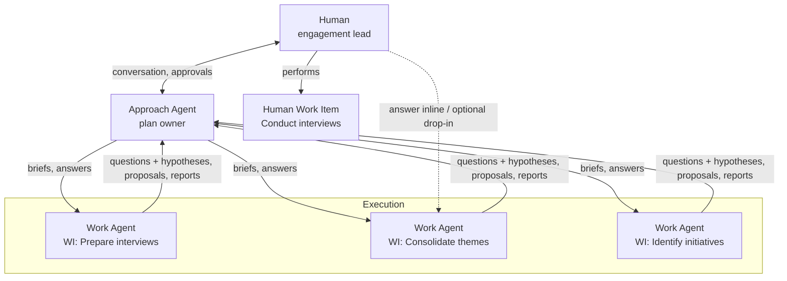
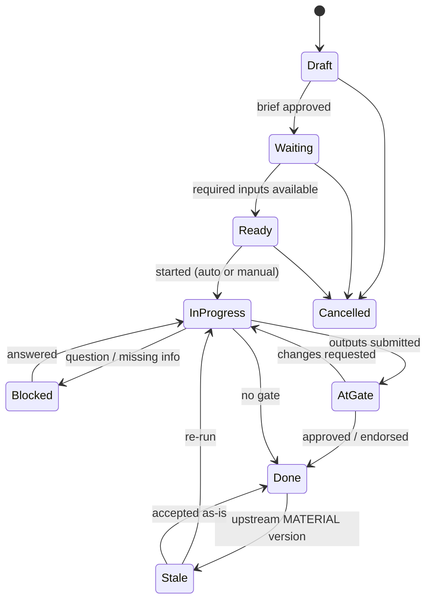

# Agentic Project Workbench — Functional Design (POC)

| | |
|---|---|
| **Status** | Draft v2.1: review feedback applied (see §13); agenda and library added from the architecture review |
| **Date** | 2026-09-23 |
| **Scope** | Functional design of a local, single-user proof of concept |
| **Companion** | [ARCHITECTURE.md](ARCHITECTURE.md): technical architecture |
| **Out of scope (for now)** | Multi-user, security, deployment |

---

## 1. Purpose

Build a local POC of a **project workbench** where a human runs a knowledge-work engagement (for example an IT strategy) with a team of AI agents. The human does not have to talk to the agents doing the work. Instead:

- The human talks to an **Approach Agent**. It shapes and maintains the **work plan**.
- The work plan is made of **work items**. Each work item consumes and produces **assets**.
- Each agentic work item is carried out by its own **Work Agent**. A Work Agent can read broadly but can only change things inside its own work item.
- Some work items are **human work items**, such as conducting executive interviews. The system prepares the human for them and collects what they produce.
- The plan is **not fixed**. The Approach Agent (with the human) changes it as the work shows what is needed. Work Agents can propose changes but cannot make them.

The central idea is to **separate *approach* (what, why, in which order) from *execution* (how)**, while letting the two talk to each other.

The POC is also an **experimentation platform**. Several key questions (plan granularity, how much humans talk to Work Agents, how strict reading rules should be) can only be answered by trying things out. Where that is the case, the design makes the behaviour **configurable** rather than fixing one answer.

### 1.1 Goals of the POC

1. Show a believable end-to-end run of a real engagement (IT strategy) in a local app.
2. Make the plan, its dependencies and its assets visible in a BPMN-inspired view, at any level of detail.
3. Show the approach/execution split: Work Agents escalate, and the Approach Agent restructures the plan.
4. Show that human work and agent work mix in one plan.
5. Produce real deliverables (Markdown, plus a PDF or PPTX export).
6. Support experimentation: settings that can change at runtime, and approaches that can be captured as reusable playbooks.

### 1.2 Non-goals of the POC

- Multi-user, authentication, authorization, security hardening.
- A full BPMN engine or BPMN 2.0 compliance.
- Production-grade scheduling, cost control or scalability.
- Integration with external PM tools (Jira, Planner, …).

---

## 2. Core Concepts

| Concept | Definition |
|---|---|
| **Engagement** | The top-level piece of work (for example "IT Strategy for Acme"). It has goals, context and constraints, plus one work plan. |
| **Workspace** *(later)* | A container above engagements. It holds playbooks, skills and, later, assets shared across engagements. The POC has a single implicit workspace. |
| **Work Plan** | A **tree of arbitrary depth** (phases, then items, then sub-items, and so on) with **dependencies** between items, which form a DAG. The plan is a living object and keeps a version history. |
| **Work Item** | A bounded unit of work with a brief, expected outputs, dependencies on input assets, an executor (**agent** or **human**), a status and its own workspace (its **locus of control**). An item with children is a **composite item**: it has no executor, and its status is rolled up from its children. |
| **Asset** | A document or file. Every asset is **owned by exactly one work item**, has a **visibility scope**, and has a **version history with minor and material versions**. Markdown is the default format. Any other format is supported. |
| **Asset Slot** | A declared *expected* output of a work item, such as "interview guide (md)". Slots exist before the asset does, so the plan can be wired up ahead of the work. They work like BPMN data objects. |
| **Visibility scope** | Who can read an asset. **Local** means only within its own work item (drafts, working notes). **Project** means anywhere in the engagement. **Workspace** *(later)* means across engagements. |
| **Approach Agent** | The agent the human talks to. It owns the engagement context and the work plan. It plans, restructures, routes messages, performs AI reviews and reports status. It does **not** do the substantive work. It is one *role*, and it can be active in several conversations at once, all working from the same plan and agenda. |
| **Agenda** | The Approach Agent's stateful memory of **open topics**: questions to handle, proposals to assess, decisions pending, follow-ups it committed to, risks. The human can see it and **prioritise** it. See §6.5. |
| **Library** | The workspace-level, searchable catalog of reusable content: playbooks now, workspace-scope assets later. See §6.6. |
| **Work Agent** | An agent bound to one work item. It is **instructed** only with its brief and declared inputs, but it has **tools to discover and read** any project-scoped asset on its own. It writes **only** inside its own work item and reports upward to the Approach Agent. |
| **Skill** | A reusable capability package: instructions, templates and tools. A skill is attached to a work item to tell its Work Agent *how* to do that kind of work, for example "interview-guide-design", "thematic-synthesis" or "pptx-export". |
| **Playbook** | A reusable **example approach** for a type of engagement, for example "IT Strategy" or "Application Landscape Rationalization". It contains a starter plan, guidance and default settings. The Approach Agent draws on it but is not bound to it. See §6.4. |
| **Gate** | A configurable checkpoint on a work item's outputs. Types are none, AI review, human review, and **formal endorsement** (a recorded decision, for example by a steering committee). See §8.2. |
| **Inbox** | The human's queue of things that need attention: questions, approvals, reviews, endorsements and human work items that are ready. |
| **Message** | A structured communication between parties (Work Agent ↔ Approach Agent ↔ Human). Messages are typed (see §7). |

### 2.1 Key design decisions (functional)

1. **Dependencies are on assets, not on items.** A work item declares which assets (or asset slots) it needs. Dependencies between items are *derived* from this. That keeps the plan honest: an item is ready because the material it needs exists, not because another item was ticked off. Pure sequencing dependencies are allowed for the rare cases that need them.
2. **Single writer per asset.** Only the owning work item can create or modify an asset. Other items can read it, subject to its visibility scope, and can ask for changes through messages, but cannot edit it. This is the "locus of control".
3. **Instruct narrowly, read broadly.** A Work Agent's instructions (its context pack) contain its brief, its declared inputs and the engagement context. It can still *choose* to look further, but only at assets with project scope (or wider). Reads beyond the declared inputs are recorded as **implicit dependencies**, so they stay visible and can be promoted to declared inputs.
4. **Hub-and-spoke communication.** Work Agents do not talk to each other directly. They communicate through the Approach Agent, or indirectly through assets.
5. **Questions come with a hypothesis.** An agent never just asks. It proposes its own best answer, which the human can approve, amend or replace in one action, or reject as the wrong question (see §7.4).
6. **Plan changes go through the Approach Agent.** Work Agents can *propose* changes to the plan. Only the Approach Agent applies them, subject to the human's autonomy settings (§8).
7. **Hybrid work is split, not blended.** Work that mixes agent and human effort becomes a composite item with separate agent and human sub-items. Views can collapse composites to hide the detail.
8. **Minor versus material versions.** Every publish is either *minor* (it does not change meaning, such as typos or formatting) or *material* (it changes content that downstream items rely on). Only material versions make downstream items stale.
9. **Everything is a readable file.** Plans, briefs, worklogs and assets are Markdown (with front-matter where structure is needed), so the whole engagement can be inspected, diffed and version-controlled.
10. **Agents take inputs as they come.** There is no mandatory conversion step for incoming documents (PDF, PPTX, XLSX, DOCX). Agents have the skills and tools to extract what they need, when they need it.
11. **Experimentation over premature fixing.** Granularity, autonomy, gates, read rules and direct-chat availability are settings, not hard-coded behaviour.
12. **The Approach Agent works from an agenda, not from one conversation.** Inputs arrive concurrently and out of order. Open topics are tracked explicitly, so nothing is lost, the human's priorities decide the order, and conversations can jump between topics freely.

---

## 3. Actors and Roles



| Actor | Can do | Cannot do |
|---|---|---|
| **Human** | Talk to the Approach Agent. Approve or reject plan changes. Answer questions. Review and endorse outputs. Perform human work items and upload their outputs. Drop into any work item. Change settings. Edit anything manually. | Nothing is blocked. The human is the ultimate authority. |
| **Approach Agent** | Create and restructure the plan. Write briefs. Assign skills and gates. Start Work Agents. Answer or route questions. Maintain engagement-level assets. Perform AI reviews. Draw on playbooks and capture new ones. Summarize status. | Write the substantive assets inside work items. |
| **Work Agent** | Read its brief, its inputs and the engagement context. Discover and read other assets with project scope. Use its skills and tools. Write its own local assets and publish its outputs. Send messages upward. Submit for review. | Modify anything outside its work item. Read another item's local assets. Talk to other Work Agents directly. |

---

## 4. The Work Item

### 4.1 Anatomy

Each work item is a small project in its own right: a folder with a brief, a log, local working files, and published outputs.

| Field | Meaning |
|---|---|
| `id`, `title` | Identity (for example `WI-004 Consolidate interview themes`). |
| `parent` | Position in the tree. Any depth is allowed. |
| `executor` | `agent` or `human`. It is left empty for composite items. |
| `brief` | What needs to be achieved and why, written by the Approach Agent. It is the Work Agent's primary instruction. |
| `inputs` | The assets or slots it depends on (optionally pinned to a version), each marked *required* or *optional*. |
| `outputs` | The asset slots it must fill, with format, description and **visibility scope** (the default is `project`). |
| `skills` | The skills attached to the Work Agent. |
| `acceptance` | Criteria the output must meet. The Work Agent self-checks against them and the gate checks them. |
| `gate` | The checkpoint type and settings (see §8.2). |
| `autostart` | Whether the item starts automatically once its required inputs exist. |
| `status` | See §4.2. |
| `worklog` | An append-only log of what the agent or human did, its decisions and assumptions. It gives continuity when an item is re-opened. |
| `implicit_inputs` | This is filled in by the system: project assets the agent read beyond its declared inputs. |

Illustrative `item.md`:

```markdown
---
id: WI-004
title: Consolidate interview themes
parent: PH-1
executor: agent
status: ready
inputs:
  - slot: WI-003/interview-notes/*     # all interview notes from the (multi-instance) human item
    required: true
  - slot: ENG/context
    required: true
outputs:
  - slot: themes
    format: md
    scope: project
    description: 5–10 cross-cutting themes, each with evidence quotes and source interview
skills: [thematic-synthesis]
gate:
  type: human-review
autostart: true
acceptance:
  - Every theme is backed by at least two interviews
  - Contradictions between executives are called out explicitly
---

## Brief
Synthesize the C-suite interview notes into the major themes for Acme's IT strategy.
Focus on business pain points, ambitions and constraints rather than technology wish-lists.
```

### 4.2 Lifecycle



- **Composite items** don't have their own lifecycle. They show a roll-up (for example "3/5 done, 1 blocked") and the "worst" child status.
- **Human items** follow the same lifecycle. "In progress" means the human is working on it.

### 4.3 Agent, human and composite items

| Kind | Example | How it works |
|---|---|---|
| **Agent item** | Prepare interview guides | The Work Agent produces the assets, self-checks them against the acceptance criteria and submits them to the gate. |
| **Human item** | Conduct CxO interview | The item appears in the Inbox with its inputs attached. The human uploads notes or transcripts into the output slots and marks it done. An optional assist agent can structure raw notes, but the human stays the owner. |
| **Composite item** | Validate initiatives with the CIO | This contains child items, for example *Draft validation pack* (agent) → *Validation session* (human) → *Process feedback* (agent). Hybrid work is always modelled this way. |

**Rendering rule:** a composite item can be **collapsed** into a single node, like a BPMN collapsed sub-process, or **expanded** inline, so the level of detail can be chosen per view (§10.2).

### 4.4 Multi-instance items (fan-out / fan-in)

Some work repeats over a list, for example one interview per executive. The Approach Agent can turn an item into a **multi-instance** item: one child per entry in a list asset (such as `stakeholders.md`). Downstream items consume the whole collection (`WI-003/interview-notes/*`). This is a special case of a composite item, and it collapses the same way.

### 4.5 Granularity and level of detail

There is no single right granularity. It has to be found by trying things out. The POC therefore supports:

- **Arbitrary depth.** Any item can be split later (`split_item`) and any group merged (`merge_items`). Nothing locks in the first decomposition.
- **A planning-granularity setting** for the Approach Agent (`coarse` · `medium` · `fine`), which playbooks can override. It steers how far the agent decomposes before starting work, versus refining just in time.
- **Just-in-time refinement.** The Approach Agent may plan later phases coarsely and refine them when they get close.
- **Level-of-detail controls** in every view: collapse to depth *n*, expand one branch, or "focus" on one composite.

---

## 5. Assets

### 5.1 Properties

- **Owner**: exactly one work item, or the engagement itself for shared context.
- **Slot**: the declared output it fills. Local working files don't need a slot.
- **Format**: `md` by default. Also `pdf`, `pptx`, `docx`, `xlsx`, images, audio or transcripts.
- **Scope**: `local` · `project` · (`workspace`, later). See §5.3.
- **Versions**: `major.minor` numbering (1.0, 1.1, 2.0, …). Each version records its author (agent or human), timestamp, **change kind** (minor or material) and a change note.
- **State**: `draft` (a work in progress, always local) or `published` (visible according to scope).
- **Consumers**: which items read it, explicitly or implicitly, and at which version.

### 5.2 Versioning: minor versus material

| Change kind | Examples | Version bump | Effect on consumers |
|---|---|---|---|
| **Minor** | Typo fixes, formatting, wording that does not change meaning, added citations | 1.0 → 1.1 | Consumers are notified ("a newer minor version is available") but stay *Done*. |
| **Material** | A theme added, removed or reframed; figures changed; a recommendation changed | 1.1 → 2.0 | Consumers that are *Done* become **Stale**. The Approach Agent explains the impact. |

- The **publisher classifies** the change: the Work Agent (with its reasoning shown) or the human.
- The human, or the Approach Agent where allowed, can **reclassify** a version afterwards. Upgrading a minor version to material makes consumers stale after the fact. Downgrading clears the staleness.
- Consumers pin the version they started with. A mid-run publish never silently changes their input.

### 5.3 Visibility scopes and reading rules

| Scope | Who can read | Typical content |
|---|---|---|
| **Local** | Only the owning item (its agent and the human) | Drafts, scratch notes, intermediate extractions, reasoning notes |
| **Project** | Every item and agent in the engagement | Published outputs, engagement context, intake documents |
| **Workspace** *(later)* | Every engagement in the workspace, found through the **library** (§6.6) | Firm-wide references, reusable frameworks, anonymized prior deliverables |

Reading rules for Work Agents:

1. **Instructions are scoped.** The context pack contains only the brief, the declared inputs (at their pinned versions) and the engagement context.
2. **Discovery is open within scope.** The agent has tools to list, search and read any asset with project scope.
3. **Implicit reads are tracked.** Reading a project asset that is not a declared input records an implicit dependency. The item shows it, and the Approach Agent can promote it to a declared input so that staleness tracking covers it.
4. **Local assets of other items are never readable.**

How strict rule 2 should be is an **experimentation setting** (`read-policy: declared-only | project | project-with-tracking`, default `project-with-tracking`).

### 5.4 Engagement-level assets

These belong to the engagement (owned by the Approach Agent), have project scope, and are readable by all items:

- `context.md`: client, goals, scope, constraints, timeline.
- `stakeholders.md`: who is who, and who is interviewed.
- `glossary.md`, `decisions.md` (the decision log, including endorsements), `assumptions.md`.
- **Intake**: documents the human drops in at the start (existing strategy decks, org charts, application inventory). They are stored **as-is**. Agents extract what they need using their document-reading skills and may keep extractions as local assets for their own reuse.

### 5.5 Deliverables and exports

Final deliverables are produced by **export work items** with export skills (`pptx-export`, `pdf-export`, `docx-export`). They consume Markdown assets and produce binary assets. Because exports are ordinary work items, they are re-runnable and go stale like everything else.

---

## 6. The Approach Agent

### 6.1 Responsibilities

1. **Shape the engagement.** Interview the human about goals, scope and constraints, and write `context.md`.
2. **Propose the plan.** Start from a playbook if a suitable one exists, otherwise from first principles. Respect the granularity setting.
3. **Run the plan.** Start ready items (according to their autostart settings), watch progress and route messages.
4. **Adapt the plan.** React to Work Agent proposals, human requests and new information.
5. **Guard quality.** Perform AI reviews where gates ask for them, and check coherence across items.
6. **Report.** Answer "where are we?", summarize changes since the last check-in and surface decisions that need the human.
7. **Capture approaches.** Offer to save a plan, or part of one, as a playbook (§6.4).

### 6.2 Plan operations

The Approach Agent changes the plan through explicit, named operations. Each one is logged and shown to the human as a readable diff:

| Operation | Example |
|---|---|
| `add_item` | Add "Current-state application landscape assessment". |
| `split_item` | Split "Conduct interviews" into one item per executive. |
| `merge_items` | Merge two overlapping analysis items. |
| `move_item` | Move an item under a different parent (re-structure the tree). |
| `update_brief` | Sharpen the brief after the human gives feedback. |
| `rewire` | Make "Identify initiatives" also depend on the landscape assessment. |
| `add_slot` / `remove_slot` | An item must now also produce a risk register. |
| `set_gate` | Require a steering-committee endorsement on the roadmap. |
| `promote_implicit_input` | Turn a tracked implicit read into a declared input. |
| `cancel_item` | Drop the benchmarking item because it's out of scope. |
| `reopen_item` | Re-run synthesis with new interview notes. |

A group of operations is presented as a **plan change proposal**, which the human can approve, reject or edit (subject to the autonomy settings in §8.1).

### 6.3 What the Approach Agent sees

- The full plan and the status of every item.
- All messages.
- Asset metadata and summaries. It can read full assets when needed.
- Available playbooks and skills.

### 6.4 Playbooks

A playbook is an **example approach**. It is supported from the start, even though the POC begins with no playbooks at all.

**Contents** (a folder of Markdown files):

- `playbook.md`: purpose, when to use it, key principles, typical pitfalls.
- A starter plan: phases, items, briefs, slots and dependencies, written as a template with placeholders.
- Default settings: granularity, gates (for example "roadmap requires steerco endorsement"), recommended skills.
- Optional example assets, such as an example interview guide or an example themes document.

**How it is used:**

- When planning, the Approach Agent looks for relevant playbooks, tells the human which one it is drawing on, and **adapts** it to the engagement. It is guidance, not a script.
- More than one playbook can inform a plan. For example, an IT strategy might include a landscape-rationalization phase.

**How playbooks are created:**

- **Capture**: "Save as playbook" turns the current engagement (or a subtree of it) into a playbook. The Approach Agent generalizes it, removing client specifics and turning concrete content into placeholders and guidance. The human reviews the result.
- **Author**: playbooks are ordinary Markdown files and can be written or edited by hand.
- Playbooks live at **workspace** level, in the library (§6.6), outside any single engagement.

### 6.5 The Approach Agenda (stateful memory)

The Approach Agent receives input from many directions at once: the human (who may jump between subjects), Work Agent questions and proposals, reviews to perform, and the impact of changed assets. Instead of processing all of this as one serial conversation, the Approach Agent keeps an **agenda of open topics**.

| Topic kind | Example |
|---|---|
| Question | "WI-002 asks how to focus the CIO interview" |
| Proposal | "WI-004 proposes a CFO follow-up interview" |
| Decision | "The human must choose between two roadmap scenarios" |
| Review | "AI review of themes 1.0" |
| Impact | "themes 2.0 is material: WI-005 is stale" |
| Request | "The human asked for a benchmarking section" |
| Follow-up | "Re-check initiatives once the CFO notes arrive" (a commitment the Approach Agent made to itself) |
| Risk / run issue | "WI-001 failed twice on the XLSX" |

**How the agenda works:**

- **Topics are created automatically** from events, by the Approach Agent (for example its own follow-ups), or by the human.
- **The human sets the priorities.** In the Agenda board the human can re-rank, pin, take a topic over ("I'll handle this"), drop a topic, or start a conversation about it ("discuss").
- **Topics can wait for a condition** ("when the CFO notes are published") and come back automatically when it is met. Follow-ups are never forgotten.
- **Conversations are free.** The human can have several conversations with the Approach Agent (a general chat, or one per topic) and switch between them. Every conversation starts with a short situation briefing from the plan and agenda, so it doesn't matter which conversation came first.
- **Background handling.** The Approach Agent works through the topics it owns in priority order, either automatically or only when asked ("work the agenda"). This is a setting.
- **Closing a topic** always records a resolution. Topics linked to a request or proposal close when that request is answered or the proposal is applied.

Alongside the agenda, the Approach Agent keeps an **approach journal**: its working hypotheses about the client, the reasoning behind the approach, and lessons learned. Together with the decision log, this is its long-term memory.

### 6.6 The Library (discoverability across engagements)

The library is a workspace-level, searchable catalog.

- **What it holds**:
  - **Playbooks** from the start.
  - **Workspace-scope assets** later: reusable frameworks, templates, anonymized prior deliverables.
- **Finding things**:
  - A Library view with search, filters by kind and tag, and preview.
  - Agents have a library search tool.
  - When planning, the Approach Agent searches the library first and says what it found.
- **Promoting content**: the human (or the Approach Agent, with the human's confirmation) promotes a published asset or a captured playbook into the library. The content is **copied**, with its provenance recorded (engagement, asset, version). A confidentiality check confirms that client-specific content has been removed.
- **Using library content**: an engagement that uses a library entry records which version it used. A later material version of that entry shows up as an impact topic on the agenda.

---

## 7. Communication Model

### 7.1 Message types

| Type | Direction | Example |
|---|---|---|
| **Brief / Instruction** | AA → WA | "Start WI-004. Focus on business pain points." |
| **Question** (always with a **hypothesis**) | WA → AA (→ Human) | "The interviews contradict each other on cloud appetite. *My hypothesis:* report both views and attribute them by role, without weighting. Alternatives: weight by seniority, or ask the sponsor." |
| **Blocker** | WA → AA | "The CFO notes are missing. I can't finish synthesis." |
| **Plan change proposal** | WA → AA, AA → Human | "Budget constraints were never discussed. Suggest a follow-up interview with the CFO." |
| **Change request** | Item → owning item (via AA) | "Initiatives item requests: add effort estimate per theme." |
| **Progress report** | WA → AA | Short status plus what is done and what is next. |
| **Completion report** | WA → AA | Summary of outputs, change kind and reasoning, assumptions, open issues, and a self-check against the acceptance criteria. |
| **Gate request / verdict** | Engine → reviewer → item | "Themes 1.0 is ready for your review." → Approved / Changes requested / Endorsed + record. |
| **FYI / Notification** | AA → Human | "3 items became ready; 1 item is stale; themes has a new minor version." |

### 7.2 Routing rules

- A Work Agent's question first goes to the Approach Agent as a **topic on its agenda** (§6.5). The Approach Agent answers from context if it can, and otherwise **escalates to the Inbox**. The escalation keeps the Work Agent's hypothesis and adds the Approach Agent's own view.
- The human can act in the Inbox, in the Approach Agent chat, or inside the work item.
- If the human interacts with a Work Agent directly, the exchange is logged in the item's worklog, and the Approach Agent is told about any decision that affects scope.

### 7.3 The human's Inbox

This is a single place for everything that needs the human:

- Questions with hypotheses.
- Plan change proposals to approve.
- Gates waiting for human review or endorsement.
- Human work items that are ready to perform.
- Stale items that need a decision, and versions whose classification is disputed.

### 7.4 Answering questions

Because every question comes with a hypothesis, the human has these actions:

| Action | Effect |
|---|---|
| **Approve** | The hypothesis becomes the answer. It is a single click. |
| **Amend** | The human edits the hypothesis, and the edited version becomes the answer. |
| **Replace** | The human writes a different answer. |
| **Wrong question → discuss** | The human signals that the question itself is off. This opens a **thread with the Approach Agent**, with the question, the hypothesis and the item's context attached. The discussion may end in a clarified brief, a plan change, or a reframed answer that is sent back to the Work Agent. The item stays *Blocked* until the discussion is resolved. |

All answers are recorded in the item's worklog. Answers the human marks as significant are also recorded in `decisions.md`.

**Direct chat with Work Agents** ("drop-in") is available as an experimental feature, enabled per engagement. The POC measures how often it is used compared with the structured question flow.

---

## 8. Autonomy, Control and Gates

### 8.1 Autonomy settings

These are set at engagement level and can be overridden per item or by a playbook:

| Setting | Values | Effect |
|---|---|---|
| **Plan changes** | `propose` (default) · `auto-minor` · `auto` | Whether the Approach Agent needs approval to change the plan. |
| **Item start** | `manual` · `auto` (default) | Whether ready agent items start by themselves. |
| **Question handling** | `aa-first` (default) · `always-human` | Whether the Approach Agent may answer Work Agent questions itself. |
| **Agenda handling** | `auto` (default) · `on-demand` | Whether the Approach Agent works its agenda in the background, or only when the human asks. |
| **Planning granularity** | `coarse` · `medium` (default) · `fine` | See §4.5. |
| **Read policy** | `declared-only` · `project` · `project-with-tracking` (default) | See §5.3. |
| **Direct chat** | `off` · `on` | See §7.4. |

There is also a global **Pause** that stops all Work Agents at their next step.

### 8.2 Gates

A gate is a configurable checkpoint on a work item's outputs. The gate type is set per item. Defaults come from the engagement settings or a playbook, and the Approach Agent can propose changes (`set_gate`).

| Gate type | Who resolves | What is recorded |
|---|---|---|
| **None** | — | The item completes once its outputs are published. |
| **AI review** | The Approach Agent, in a dedicated review step, against the acceptance criteria | A verdict and comments. It can escalate to the human if it is unsure. |
| **Human review** | The engagement lead | A verdict (approve or request changes) and comments. |
| **Formal endorsement** | A named forum or role (for example a steering committee or the CIO), recorded by the human | A **decision record**: forum, date, participants, the asset version endorsed, outcome (endorsed, endorsed with conditions, or rejected), conditions and rationale, and optional evidence (such as minutes). The record is added to `decisions.md` and the timeline. |

Gates can be **chained**, for example an AI review followed by human review, followed by a steerco endorsement. Endorsing a specific version matters: a later *material* version of an endorsed asset is flagged as **"endorsement outdated"**.

---

## 9. Versioning, History and Context

- **Every engagement is a version-controlled workspace.** Each work item's folder is its locus of control. Every published asset version, plan change, gate verdict and worklog entry is part of the history (see ARCHITECTURE.md for the Git model).
- **Timeline view**: the human can see how the plan and the assets evolved, and why.
- **Context continuity**: when an item is re-opened, its Work Agent gets the brief, the current inputs, its previous outputs, its worklog and the reason for re-opening.
- **Context pack** for a Work Agent run:
  1. Engagement `context.md` (always).
  2. The item brief and acceptance criteria.
  3. The pinned declared inputs.
  4. The attached skills.
  5. The item's worklog, previous outputs and gate feedback (if re-run).
  6. Discovery tools for other project-scope assets (depending on the read policy).

---

## 10. User Experience (POC screens)

### 10.1 Layout

```
┌───────────────────────────────────────────────────────────────────────────┐
│  Engagement: IT Strategy – Acme      [Pause] [Settings ▾]      Inbox (3)  │
├──────────────────────┬────────────────────────────────────────────────────┤
│ Conversations ▾      │   Workflow | Tree | Assets | Timeline | Library    │
│  • General           │                                       Depth: [2▾]  │
│  • WI-001 question   │   (BPMN-lite canvas, see 10.2)                     │
│ ─────────────────    │                                                    │
│ Agenda ▾             │                                                    │
│  📌 CFO follow-up    │                                                    │
│  ◻ themes 2.0 impact ├────────────────────────────────────────────────────┤
│  ◻ WI-001 run issue  │   Selected item / asset detail panel               │
└──────────────────────┴────────────────────────────────────────────────────┘
```

### 10.2 Workflow view (BPMN-inspired)

| Element | Notation | Meaning |
|---|---|---|
| **Swimlanes** | Horizontal lanes: *Human*, *Agents* | Who executes. |
| **Task** | Rounded rectangle, with an icon for agent 🤖 or human 👤 | A leaf work item. |
| **Sub-process** | A rectangle with ⊞ (collapsed) or an expanded frame containing children | A composite item or phase. |
| **Multi-instance** | ≡ marker | A fan-out composite. |
| **Data object** | Document icon between tasks; a dashed outline while the slot is still unfilled | An asset slot, labelled with its current version. |
| **Implicit read** | A dotted line from the data object to the task | An implicit dependency. |
| **Gateway** | Diamond: ◇ review, ◆ endorsement (with forum label) | A gate. |
| **Status** | Fill colour or badge | Draft · Waiting · Ready · In progress · Blocked · At gate · Done · Stale. |

**Level of detail:** a global depth control, per-node expand and collapse, and a "focus" mode that shows one composite and its immediate context. A collapsed composite shows a roll-up badge (for example "4/6 ✓, 1 ⚠").

Unapproved proposals are shown as a "ghost" overlay of the pending plan change.

### 10.3 Other views

- **Tree view**: the plan as an outline with status and depth control.
- **Item detail**: brief, inputs (declared and implicit, with versions), outputs, acceptance criteria, gate, live activity stream, worklog, messages, drop-in chat (if enabled), and Run / Re-run / Cancel controls.
- **Asset viewer**: rendered Markdown, version picker with minor/material markers, a **diff between versions**, a list of consumers, endorsement status and a download button.
- **Inbox**: see §7.3. Every entry can be actioned in place (approve, amend or replace a hypothesis; review; endorse).
- **Timeline**: plan versions, asset versions, gate verdicts and decisions over time.
- **Agenda board**: the Approach Agent's open topics by status, with re-ranking, pinning, "I'll handle", "discuss" and drop.
- **Library**: search and browse playbooks (and later workspace assets), preview them, "save as playbook" and "promote to library".

---

## 11. Running Example: IT Strategy (demo script)

**Step 1: Kick-off.**
The human tells the Approach Agent: *"I need to develop an IT strategy for Acme, a mid-size manufacturer. Interviews with the CEO, CFO, COO and CIO. Deliverable is a board deck in six weeks, endorsed by the steerco."* The Approach Agent asks clarifying questions and writes `context.md` and `stakeholders.md`. The human drops in last year's strategy deck (PPTX) and an application inventory (XLSX), which are stored as-is.

**Step 2: Plan proposal (no playbook yet).**
The Approach Agent finds no matching playbook, plans from first principles and proposes:

```
PH-1 Discovery
  WI-001 Analyse intake documents                  🤖  → current-state-summary.md
  WI-002 Prepare interview guide                   🤖  → interview-guide.md
  WI-003 Conduct CxO interviews  [≡ per exec]      👤  → interview-notes-{exec}.md
PH-2 Synthesis
  WI-004 Consolidate themes                        🤖 ◇ human review → themes.md
  WI-005 Identify initiatives                      🤖  → initiatives.md
  WI-006 Prioritise & roadmap                      🤖 ◆ steerco endorsement → roadmap.md
PH-3 Deliverable
  WI-007 Board deck                                🤖  → it-strategy.pptx, .pdf
```

The human collapses PH-2 and PH-3 in the view to focus on Discovery, and approves.

**Step 3: Parallel agent work.**
WI-001 reads the PPTX and XLSX directly using its document skills. It keeps its extractions as local assets and publishes `current-state-summary.md` 1.0. WI-002 starts when its inputs exist.

**Step 4: Question with a hypothesis.**
WI-002 asks: *"The CIO has been in the role for 3 months. Hypothesis: focus the CIO section on vision and first impressions rather than history."* The Approach Agent can't decide and escalates it. The human **amends** it: "…and ask explicitly about inherited commitments." WI-002 finishes and publishes after a human review.

**Step 5: A question that is off.**
WI-001 asks how to weight the application inventory's cost figures. The human marks it **wrong question → discuss**, because cost analysis is out of scope for discovery. The Approach Agent thread ends with a clarified brief for WI-001 (`update_brief`), and WI-001 continues.

**Step 6: Human work.**
WI-003 expands into four child items, one per executive, in the Human lane. The human uploads pre-written notes.

**Step 7: Synthesis and plan adaptation.**
WI-004 reports that budget appetite was never explored with the CFO and proposes a follow-up. The Approach Agent turns this into *Proposal #7: add WI-003e "CFO follow-up"; re-run WI-004 after it*. The human approves it.

**Step 8: Minor versus material.**
A typo fix to `themes.md` is published as 1.1 (minor), so WI-005 only gets a notification. After the CFO follow-up, `themes.md` 2.0 (material) adds a "funding model" theme, so WI-005 goes **stale** and re-runs.

**Step 9: Formal endorsement.**
WI-006 produces the roadmap. After the human review, the item waits at the ◆ steerco gate. The human records the endorsement: forum *Steerco*, date, participants, outcome *endorsed with conditions* ("ERP consolidation moves to year 2"), with the minutes attached. The decision appears in `decisions.md` and on the timeline.

**Step 10: Export.**
WI-007 generates the board deck (PPTX) and a PDF.

**Step 11: Capture the approach.**
The human asks the Approach Agent to "save this as an IT Strategy playbook". The Approach Agent generalizes the plan, briefs, gates and example assets into a playbook, which the human reviews and saves. A new engagement can now start from it.

**Step 12: Look back.**
The Timeline shows plan v1 → v6, every asset version (minor and material), both questions and how they were resolved, and the endorsement.

---

## 12. POC Scope

### 12.1 In scope

- One engagement at a time, local, single user.
- Approach Agent chat with plan creation and plan operations as proposals.
- Agent, human and composite items with arbitrary depth, and collapse/expand in all views.
- Asset dependencies, readiness, minor/material versioning, staleness propagation.
- Visibility scopes `local` and `project`, with implicit-read tracking.
- Work Agents confined to their own item.
- Questions with hypotheses (approve, amend, replace, or discuss), proposals, completion reports. Inbox.
- Configurable gates, including formal endorsement with decision records.
- The Approach Agenda: topics, human prioritisation, waiting conditions, several conversations.
- The Library: a searchable catalog with playbooks. Use playbooks when available, capture them, author them by hand, promote content.
- Workflow (BPMN-lite), tree, item detail, and asset viewer with version diff.
- Skills: document extraction, interview guide, thematic synthesis, PPTX/PDF export.
- History of plan and asset versions. The settings panel for the experimentation settings.

### 12.2 Deferred / nice-to-have

- Workspace-scope assets and multiple engagements side by side.
- Automatic multi-instance fan-out from a list asset (a manual split is fine at first).
- The Timeline view (history is recorded from day one).
- Cost and token budgets per item. Audio transcription.

### 12.3 Success criteria

1. The demo script in §11 can be run end to end in about 30 minutes (with pre-written interview notes).
2. At least one plan change is initiated by a Work Agent and one by the human.
3. Questions are shown with hypotheses, and at least the amend and "wrong question → discuss" paths are demonstrated.
4. The minor-versus-material distinction is visible: one notification-only update and one staleness → re-run cycle.
5. A formal endorsement is recorded and appears in the decision log.
6. The final PPTX/PDF is generated from Markdown assets.
7. A playbook is captured from the finished engagement.
8. No Work Agent has modified anything outside its own work item.

---

## 13. Review Decisions (v1 → v2)

| # | Question | Decision |
|---|---|---|
| 1 | Plan granularity | Find it by experimenting. The POC supports arbitrary depth, split and merge, a granularity setting, and just-in-time refinement (§4.5). |
| 2 | Hybrid items | **Split** into agent and human sub-items under a composite, rendered as a collapsible sub-process (§4.3). |
| 3 | Direct human ↔ Work Agent chat | Also experimental. The primary path is **questions with hypotheses** (approve, amend, replace), plus **"wrong question → discuss with the Approach Agent"**. Drop-in chat is a setting (§7.4). |
| 4 | Staleness policy | **Minor and material versioning.** Only material versions cause staleness, and versions can be reclassified (§5.2). |
| 5 | Work Agent read scope | **Instructions are scoped; discovery is open within visibility scope.** Scopes are local, project and (later) workspace. Implicit reads are tracked (§5.3). |
| 6 | Playbooks | Supported from day one as **example approaches**, with no initial content. Playbooks can be captured from engagements (§6.4). |
| 7 | AI review gates | **Configurable gates**, including **formal endorsement** with decision records, for example by a steerco (§8.2). |
| 8 | Non-Markdown inputs | **No forced conversion.** Agents extract what they need using skills (§5.4). |

### 13.1 Remaining open questions

1. Should the Approach Agent be allowed to *reclassify* version kinds (minor ↔ material) without asking the human?
2. When a Work Agent makes many implicit reads, is that a signal that the brief or the inputs are wrong, and should the Approach Agent react automatically?
3. Should endorsement conditions become new work items automatically (for example "move ERP consolidation to year 2")?
4. Should playbooks be versioned, and should engagements record which playbook version they used?

---

## 14. Next Steps

1. **Architecture design** has started in [ARCHITECTURE.md](ARCHITECTURE.md).
2. Validate the SDK assumptions with a technical spike (ARCHITECTURE.md §13).
3. Initialize the repository and folder structure.
4. Build the POC in the milestone order from ARCHITECTURE.md.
5. Prepare demo content: a fictional Acme context, intake documents (PPTX/XLSX) and pre-written interview notes.

---

## Appendix A: Glossary

- **Locus of control**: the part of the workspace a Work Agent can modify, which is its own work item folder.
- **Composite item**: an item with children. It has no executor, and its status is rolled up from its children.
- **Minor / material version**: a publish that does or does not change meaning for consumers. Only material versions cause staleness.
- **Stale**: a completed item whose inputs have a newer *material* version than the one it used.
- **Ready**: all required input assets are published and all sequencing dependencies are done.
- **Implicit dependency**: a project asset an agent read beyond its declared inputs.
- **Hypothesis**: the answer an agent proposes together with its question.
- **Endorsement**: a formal gate verdict by a named forum, stored as a decision record against a specific asset version.
- **Playbook**: a reusable example approach (starter plan, guidance, defaults).
- **Proposal**: a set of plan operations waiting for approval.
