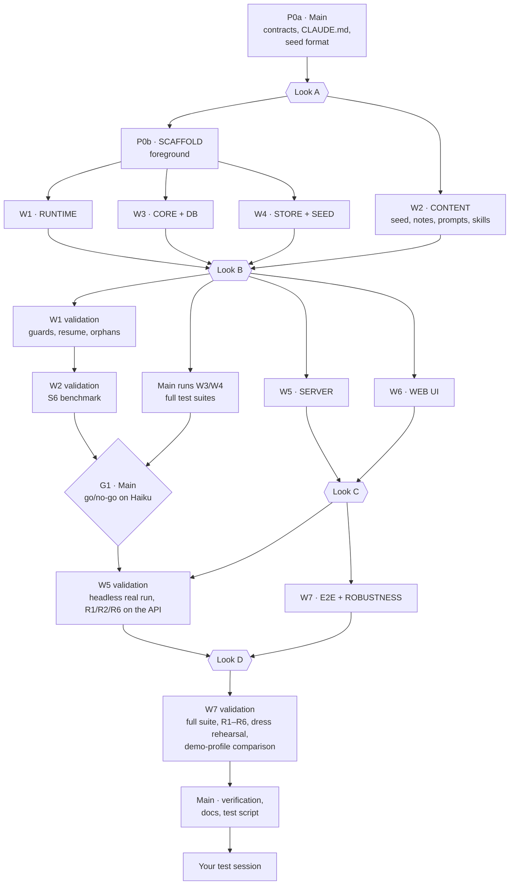

# I1 — Walking Skeleton: Implementation Plan

| | |
|---|---|
| **Status** | Draft v1, awaiting approval (§2) |
| **Date** | 2026-09-23 |
| **Goal** | Deliver I1 as specified in [ITERATIONS.md §4](../ITERATIONS.md): journeys **J1.1–J1.8** and robustness journeys **R1–R6**, meeting the definition of done in ITERATIONS §1.2 |
| **Execution model** | The main session (orchestrator) plus **Sonnet subagents** for implementation. The main session owns the contracts, reviews, independent re-checks and documentation. |
| **Key rule** | **Look before long validation.** Every agent stops once it has built its package and run a quick smoke check. You take a quick look, and only after your go does the agent run its lengthy validation (§3). |
| **Agent model under test** | `claude-haiku-4-5` (`test` profile) for every SDK run, unless a step says otherwise |

---

## 1. What I1 delivers

A local app, started with `pnpm dev`, in which a human:

1. starts an engagement from the seed `acme-discovery` (J1.1);
2. sees the plan as a process (J1.2);
3. watches real Work Agents run (J1.3);
4. answers their questions, each of which comes with a hypothesis (J1.4);
5. reviews their outputs (J1.5);
6. performs a human item (J1.6);
7. edits a brief before an item runs (J1.7);
8. inspects everything on disk (J1.8).

The app also survives restarts, crashes and misbehaving agents (R1–R6).

**Repository layout** at the end of I1 (following A§19):

```
ai-project/
├── CLAUDE.md                 # conventions for every agent (§8), written by main
├── package.json, pnpm-workspace.yaml, tsconfig.base.json, workbench.config.yaml
├── packages/
│   ├── core/                 # contracts (main) + pure engine rules (W3)
│   ├── db/                   # Drizzle schema (main) + migrations, repositories, leases (W3)
│   ├── store/                # file store, seed loader, Git service, projections (W4)
│   ├── agents/               # SDK adapter, guards, work toolset, runs, fake agent (W1); prompts/ (W2)
│   └── server/               # Fastify + WS, services, scheduler, reconciliation (W5)
├── apps/web/                 # React UI (W6)
├── workbench-skills/         # Claude Code plugin: protocol + method skills (W2)
├── demo/
│   ├── seeds/acme-discovery/ # seed in the playbook starter-plan format (W2)
│   └── interview-notes/      # 4 pre-written notes for J1.6 (W2)
├── e2e/                      # Playwright journey tests + robustness scripts (W7)
├── iterations/
│   ├── I1-PLAN.md            # this file
│   └── I1/looks/, I1/reports/   # look reports and validation reports (§3.3, §3.5)
├── spike/                    # M0, kept as reference; code is ported, never imported
└── workspace/                # default workbench home (git-ignored)
```

---

## 2. Prerequisites (need you)

1. **Branch**: work happens on a branch named `iteration/i1`, created from `main`. The main session commits there at each gate (§4). It merges to `main` only after the test session.
2. **API key**: the app resolves `ANTHROPIC_API_KEY` in the same order as the spike:
   1. the process environment;
   2. the repo-root `.env`;
   3. the Windows user environment variable.

   If your key is only in `spike/.env`, copy it to the root `.env`, which is git-ignored.
3. **API budget** (details in §9):

   | Scope | Estimate | Cap |
   |---|---|---|
   | `test` profile (Haiku): smoke runs, validations, S6, dress rehearsal, test session | $6–10 | $16 |
   | `demo` profile comparison (J1.3 and J1.5 once) | $2–4 | $4, **run only after your explicit OK at Look D** |
4. **Model for the `demo` profile**: A§4 still names `claude-opus-5`. I propose `claude-opus-5-5`.
5. **Claude Code usage**: M0 stopped early because the Claude Code session limit was hit. To avoid that:
   - at most **3 subagents run at the same time**;
   - the look points (§3) pause work naturally;
   - if a limit is hit anyway, every agent's state is in its look or validation report, so work resumes cleanly.

---

## 3. Look points: stop before long validation

### 3.1 The rule

Every work package is done in two halves, with a stop in between:

```
BUILD ──► quick checks ──► STOP: look report ──► (you look, give feedback or go) ──► fixes ──► FULL VALIDATION ──► validation report
```

| Allowed **before** the stop (quick checks) | **Not** allowed before your go (full validation) |
|---|---|
| Typecheck, lint, unit tests that finish in under about 60 seconds | Benchmarks (S6) and any loop of repeated agent runs |
| At most **2 real SDK runs** in total, **≤ $0.10**, listed as the package's smoke check | Guard and canary batteries |
| Any number of runs on the **scripted fake agent** | Real-agent end-to-end runs of the seed |
| Starting the app briefly to check that it boots (then stopping it) | The full Playwright suite |
| | Restart, kill and orphan tests (R1, R2) |
| | Multi-process stress tests (the lease race) |
| | Anything on the `demo` profile |

An agent that reaches its look point **writes its look report, returns it, and ends its turn**. It does not wait or poll. Your go or your feedback is sent to **the same agent** through `SendMessage`, so it keeps its full context.

- **Feedback that changes something visible** → the agent fixes it and returns a new look report.
- **Otherwise** → the agent fixes it and continues straight into validation.
- **"Go"** → the agent runs the validation plan from its look report, then returns a validation report.

### 3.2 Look sessions

Look points that arrive close together are **batched** into four look sessions, so you are interrupted four times, not ten. Before relaying a batch, the main session does its own 5-minute review of each package: contract violations, obvious gaps, cost. Its notes come on top of the agents' reports.

| Look session | Contains | What you do | Your time |
|---|---|---|---|
| **A: Foundations** | L0: contracts, seed format, conventions | Read the domain types, the API surface and the seed format | ~15 min |
| **B: First agent run** | L1: a real WI-002 run · L2: seed, prompts and skills · L3: the lifecycle table · L4: the engagement on disk | Read one agent's activity log and output; read the briefs and notes; check the lifecycle; open the engagement folder and `git log` | ~20–30 min |
| **C: Click through** | L5: server with the fake agent · L6: the UI | Run `pnpm dev:fake` and click through J1.1–J1.8 in the browser, at no API cost | ~20–30 min |
| **D: Before the dress rehearsal** | L7: journey tests written, one green | Optionally walk J1.3–J1.5 once with real Haiku; approve the long validation and the `demo`-profile comparison | ~10–20 min |

Look A blocks everything, because the contracts are the foundation for all parallel work. Looks B, C and D block only the *validation* of their packages. Building continues where it doesn't depend on the outcome (§4).

### 3.3 Look report template

Written to `iterations/I1/looks/L<n>-<package>.md` and returned as the agent's final message:

```markdown
# L<n> — <package>: ready for a look

**Built:** <one paragraph>   **Quick checks:** typecheck ✔ · unit tests ✔ (n) · smoke: <what ran>   **API spent:** $x.xx

## Take a look (≤ 10 minutes)
1. <exact command, run from the repo root>
2. <file or URL to open, and what to notice in it>

## Questions for you
- <decisions the agent made that you may want to overrule>

## Known gaps and shortcuts (not yet validated)

## Contract change requests
<none | what, why>

## Validation plan (runs only after your go)
| Step | What it proves | Duration | API cost |
```

### 3.4 After a look

| Your reply | What happens |
|---|---|
| **"go"** | The agent runs the validation plan. |
| **Feedback** | The agent applies it, then either returns a new look report (if the change is visible) or continues into validation. |
| **"hold"** | The package pauses and the agent's context is kept. It is resumed later with SendMessage. |
| **Contract change** | The main session decides, updates the contract, and tells every affected agent. |

### 3.5 Validation report template

Written to `iterations/I1/reports/W<n>-<package>.md`. It uses the FINDINGS style from M0: a verdict, a results table **with evidence**, cost, surprises, deviations from ARCHITECTURE.md, and open issues. The evidence rule from M0 applies: nothing is reported as observed unless it was observed.

---

## 4. Orchestration



| Phase | Who | Mode | What | Ends with |
|---|---|---|---|---|
| **P0a** | Main | — | Contracts (§5), `CLAUDE.md` (§8), the branch | **Look A** |
| **P0b** | SCAFFOLD (Sonnet) | Foreground | Workspace, packages, tooling, config and env loaders | Main reviews; no look needed (there is nothing to validate at length) |
| **P0b′** | W2 CONTENT (Sonnet) | Background, alongside SCAFFOLD | Seed, interview notes, prompts, skills | L2 (held for Look B) |
| **1** | W1, W3, W4 (Sonnet) | Background, **3 in parallel** | Runtime · core rules + DB · store + seed | L1, L3, L4 → **Look B** |
| **2** | W5, W6 (Sonnet) + W1 then W2 validating | Background; at most 3 agents active | Server · UI · V1 → S6 | L5, L6 → **Look C**; S6 → **G1** |
| **3** | W5 validating, W7 (Sonnet) | Background | V5 · E2E and robustness | L7 → **Look D** |
| **4** | W7 validating, then Main | — | V7, then independent verification | Test session |

**Commits**: the main session commits to `iteration/i1` after Look A, after each package's validation report is accepted, and after G1. Agents never commit.

**Why this split** (the same reasoning as M0):
- Sonnet agents do the implementation, the smoke checks and the validation runs.
- The main session keeps the parts that need architectural judgement:
  - the contracts that all parallel work depends on;
  - reviewing packages before each look;
  - independent re-checks of the critical claims (§10);
  - the documentation changes.

---

## 5. P0a — Contracts (main session)

These are written before any agent starts. They are **read-only** for agents; changes go through a contract change request (§3.4).

| File | Content |
|---|---|
| `packages/core/src/domain.ts` | Zod schemas and types: `ItemId`, `SlotRef`, `Actor`, `ItemStatus`, `ItemDef` (as `item.md` front-matter), `OutputSlot`, `InputRef`, `AssetVersion` (`major.minor`, `kind`, author, note, run), `Request` (I1: `question` and `gate_request`), `QuestionPayload`, `AnswerMode` (`approve`/`amend`/`replace`), `GateVerdict`, `Run` (reason, outcome, cost, turns, model, prompt hash), `Settings` (the I1 subset) |
| `packages/core/src/events.ts` | The event union, for example `EngagementCreated`, `ItemStatusChanged`, `AssetPublished`, `WorklogAppended`, `RequestOpened`/`RequestResolved`, `RunStarted`/`RunActivity`/`RunEnded`, `GuardDenied`, `BriefEdited`, `GateVerdictRecorded`, `FeedbackNoted`. Each event has an envelope: `seq`, `at`, `actor`, `engagementId`. |
| `packages/core/src/activity.ts` | The **readable activity item** that W1 produces, W5 stores and pushes, and W6 renders: `{kind: text \| tool \| denial \| progress \| publish \| question \| submit \| nudge \| result, summary, detail?, at}` |
| `packages/core/src/ports.ts` | **`WorkPort`**: what the work tools call on the server side (`getBrief`, `publishAsset`, `appendWorklog`, `raiseQuestion`, `reportProgress`, `submitOutputs`). **`AgentRuntime`**: `startRun(item, reason, input) → RunHandle`, where `RunHandle` has an activity stream, `interrupt()` and `done: Promise<RunOutcome>`. The real runtime and the scripted fake agent both implement it. Also `EngagementPaths`. |
| `packages/core/src/api.ts` | REST routes with Zod request and response schemas, plus the WebSocket envelope. For I1: engagements and seeds, plan, item detail, runs and activity, assets and versions, Inbox, answer, gate verdict, upload, brief edit, start/stop/resume, feedback, and the cost total. |
| `packages/core/src/config.ts`, `layout.ts`, `termination.ts` | The config shape and defaults (including the `demo` model), the workspace and engagement disk layout helpers, and the run termination rule with the one nudge |
| `packages/core/src/seed.ts` | The seed manifest schema, which equals the playbook starter-plan format (`plan.template.yaml` + `defaults.yaml` + `assets/`), so I7 can reuse it |
| `packages/db/src/schema.ts` | The Drizzle tables for I1 (a subset of A§6.2): `items`, `item_inputs`, `item_outputs`, `asset_versions`, `consumptions`, `runs`, `requests`, `gate_steps` (single step), `sessions` (leases, including `pid`), `events`. Feedback goes to `workspace/feedback.jsonl` (ITERATIONS §1.3), plus a `FeedbackNoted` event. |
| `CLAUDE.md` | The conventions for every agent (§8) |

**Look A**: you read `domain.ts`, `api.ts`, `seed.ts` and `CLAUDE.md`. The main session adds a one-page overview to the look report.

---

## 6. Work packages

Each package lists its paths (the only places the agent writes), what it depends on, what it builds, the spike code it can port, its smoke check, its look point, its validation and its API cap.

### P0b — SCAFFOLD

| | |
|---|---|
| **Paths** | Root config files, empty package skeletons, `apps/web` skeleton, `e2e/` skeleton |
| **Depends on** | Look A |
| **Builds** | <ul><li>The pnpm workspace (Node 26, pnpm 11) and `tsconfig.base.json` (strict).</li><li>Every dependency from A§4, **pre-installed per package**: SDK `0.3.280` pinned exactly, Zod, Fastify + `@fastify/websocket`, `better-sqlite3@^13` + Drizzle, `gray-matter`, `yaml`, `simple-git`, React 19 + Vite, `@xyflow/react`, `elkjs`, TanStack Query, Zustand, `react-markdown` + `remark-gfm`, Vitest, Playwright.</li><li>Scripts: `pnpm dev`, `pnpm dev:fake` (runtime replaced by the fake agent), `pnpm test`, `pnpm typecheck`, `pnpm e2e`.</li><li>The `workbench.config.yaml` loader with profiles.</li><li>The env loader and `sdkEnv()`, ported from `spike/src/lib/env.ts`.</li><li>`paths.ts`, ported with its tests.</li><li>A boot page that shows "server connected (WS)".</li></ul> |
| **Ports** | `spike/src/lib/{env,paths}.ts` (+ `paths.test.ts`) |
| **Smoke** | `pnpm install`, `pnpm typecheck`, `pnpm test`, and `pnpm dev` boots and serves the page (then it is stopped) |
| **Look** | None. Main reviews. |
| **Cap** | $0 |

### W1 — RUNTIME (`packages/agents`, except `prompts/`)

| | |
|---|---|
| **Depends on** | P0b |
| **Builds** | <ul><li>**`sdk.ts`**: the single SDK adapter, with the exact options from M0-FINDINGS §2 / A§8.2 and a pinned `CLAUDE_CONFIG_DIR`. It uses `spawnClaudeCodeProcess` to record each child's PID (needed for the orphan cleanup), and has a dev cost guard (a ledger plus a cap, ported from `spike/src/lib/run.ts`).</li><li>**Guards**: PreToolUse and PostToolUse following A§8.5 layer 3, including denying the `work` toolset when `agent_id` is present. Unit tests.</li><li>**The `work` toolset**, bound per run over `WorkPort`.</li><li>**The run lifecycle**:<ul><li>run reasons `start`, `resume-answer` and `changes-requested`;</li><li>JSONL stream per run in `.workbench/runs/`;</li><li>mapping SDK messages to activity items;</li><li>cost and turns;</li><li>`interrupt()`;</li><li>termination classification (submitted / blocked / nothing → **one nudge** → run issue).</li></ul></li><li>**The scripted fake agent**, implementing `AgentRuntime`: per-item YAML scripts of tool calls against the same `WorkPort`, emitting the same activity. It has scripts for WI-002 and WI-004, including a question and a changes-requested path.</li><li>**The CLI driver** `pnpm agents:try <seed> <item> [--fake]`: runs one item against a temporary engagement with an in-memory `WorkPort` and prints the activity in readable form.</li></ul> |
| **Ports** | `spike/experiments/s03-guards/guards.ts` (+ tests), `s04-toolsets/workToolset.ts`, `s05-resume/*`, `spike/src/lib/run.ts` |
| **Smoke** | Unit tests; one fake run; **1 real Haiku run of WI-002** (≤ $0.10) |
| **Look L1** | `pnpm agents:try acme-discovery WI-002`, plus the saved output of the real run. You read the readable activity log, the draft in `work/`, the published `interview-guide` v1.0 and the worklog. You also check whether the agent asked a question and whether its hypothesis made sense. |
| **Validation V1** | <ol><li>The guard canary battery, ported from s03, run against the **production** guards: every tool, every path form, a subagent delegation and read-only shell commands. Zero leaks, verified by hash.</li><li>Resume from a new process with a pinned config dir.</li><li>`interrupt()`, then resume.</li><li>The nudge path: a prompt variant that makes the agent stop without submitting.</li><li>**Hard-kill orphan test**: kill the parent process, then check that the recorded PIDs identify every surviving child (the input for R2).</li></ol> |
| **Cap** | Smoke $0.25 · V1 $1.50 |

### W2 — CONTENT and PROTOCOL (`demo/`, `workbench-skills/`, `packages/agents/prompts/`)

| | |
|---|---|
| **Depends on** | Look A (the seed format); starts alongside SCAFFOLD |
| **Builds** | <ul><li>**`demo/seeds/acme-discovery/`**, following ITERATIONS §4.1:<ul><li>an IT strategy for Acme, per D§11;</li><li>stakeholders CEO, CFO, COO and CIO. It reuses the text and names from `spike/fixtures/engagement-template/` where they fit, with the CIO new in the role;</li><li>the items PH-1 (WI-002, WI-003) and PH-2 (WI-004), with briefs, acceptance criteria, inputs, outputs and gates;</li><li>WI-002's brief contains the deliberate CIO ambiguity.</li></ul></li><li>Four pre-written interview notes in `demo/interview-notes/`, written so that the themes in them overlap and contradict each other, and so that CFO budget appetite is left *un*explored. That gap is used in I2 (J2.5).</li><li>`prompts/work-agent.md`.</li><li>The `workbench-protocol` skill.</li><li>The `interview-guide-design` and `thematic-synthesis` skills, in the `workbench-skills` plugin.</li></ul> |
| **Smoke** | The seed validates against `seed.ts` (a script) |
| **Look L2** | You read the context, the stakeholders, the three briefs, the four notes, the Work Agent prompt and the protocol skill. This is the moment to correct tone, realism and the level of detail. |
| **Validation (S6)** | Runs **after V1** (it needs the validated runtime). This is the carried-over M0 benchmark:<ul><li>10 runs of WI-002 with the real prompt and skills, 5 of them with the ambiguity strengthened;</li><li>protocol placement **A** (system prompt) against **B** (skill), 5 + 5 runs;</li><li>scoring per M0-SPIKE-PLAN S6: published, correct slot, plausible kind, submitted with a self-check, and on ambiguity a question with a hypothesis followed by a stop; plus turns, cost and denials;</li><li>criterion: **≥ 8/10**, possibly after fixes to the prompt or tools, followed by a re-run.</li></ul>Results go to `iterations/I1/reports/S6-haiku-protocol.md`. |
| **Cap** | S6: $3.00 |

### W3 — CORE RULES and DB (`packages/core/src/rules/`, `packages/db`, except `schema.ts`)

| | |
|---|---|
| **Depends on** | P0b |
| **Builds** | <ul><li>**Pure rules**:<ul><li>the lifecycle state machine for I1, including R5 (stop → `ready`, session kept) and the human-item transitions;</li><li>readiness from declared inputs and sequencing;</li><li>version numbering;</li><li>single-step gate transitions (the verdict is bound to the exact version submitted);</li><li>run termination decisions (submitted / blocked / nudge / run issue).</li></ul></li><li>**DB**:<ul><li>migrations;</li><li>repositories for every I1 table;</li><li>the Inbox query (open questions to the human, open human gates, ready human items, run issues);</li><li>leases (`BEGIN IMMEDIATE` + a conditional upsert, ported from s08), with the PID;</li><li>the event append and read;</li><li>the WAL checkpoint helper.</li></ul></li><li>`pnpm core:transitions`, which prints the transition table as Markdown.</li></ul> |
| **Ports** | `spike/experiments/s08-sqlite/src/{schema,leases}.ts` |
| **Smoke** | Vitest (fast suite) |
| **Look L3** | `pnpm core:transitions`: check the lifecycle table against D§4.2 and R5. Optional, and about 5 minutes. |
| **Validation** | The full suite, including the **multi-process lease race** (200 rounds across 5 processes) and repository tests on a real file DB. **The main session runs it** (it is just a command); failures are sent back to W3. |
| **Cap** | $0 |

### W4 — STORE and SEED (`packages/store`)

| | |
|---|---|
| **Depends on** | P0b; the seed format (not W2's content; it uses a minimal test seed until W2 delivers) |
| **Builds** | <ul><li>**The file store**:<ul><li>`item.md` read and write through `gray-matter`, keeping the body;</li><li>append-only `worklog.md`;</li><li>immutable version files `assets/<slot>/vX.Y.<ext>`;</li><li>uploads;</li><li>a serialised write queue.</li></ul></li><li>**The seed loader**: from seed to engagement folder, plus `engagement.yaml`.</li><li>**The Git service**: `git init`, `.gitignore`, checkpoint commits with actor attribution and trailers (`Workbench-Event`, `Workbench-Run`). The caller runs the WAL checkpoint first; the service asserts that it happened.</li><li>**The `plan.md` projection.**</li><li>`pnpm seed:try <seed>`, which creates an engagement in `workspace/` without a server.</li></ul> |
| **Smoke** | Vitest; `pnpm seed:try acme-discovery` |
| **Look L4** | Open `workspace/engagements/acme-discovery-*`. Check the folder layout against A§5.2, the `item.md` files, the engagement assets at `v1.0.md`, `plan.md` and `git log --format=full`. |
| **Validation** | The full suite: Git round trips, immutability (overwriting a published version must fail), and paths with spaces and mixed case on Windows. **The main session runs it.** |
| **Cap** | $0 |

### W5 — SERVER (`packages/server`)

| | |
|---|---|
| **Depends on** | Look B (W1, W3, W4 as built; their validation runs in parallel) |
| **Builds** | <ul><li>Fastify and WebSocket, following `api.ts`.</li><li>**The event bus**: persists events and fans them out.</li><li>**Services**, which are the only code that writes files and the DB, file first and then the DB transaction:<ul><li>create an engagement from a seed;</li><li>the real `WorkPort` (publish, worklog, question, progress, submit);</li><li>answers (approve / amend / replace, then resume);</li><li>gate verdicts (approve, or request changes then resume);</li><li>human uploads and mark-done;</li><li>brief edits (only while `waiting` or `ready`);</li><li>start, stop and resume;</li><li>feedback;</li><li>cost totals.</li></ul></li><li>**The scheduler**: autostart, concurrency limit of 3, and a lease per item.</li><li>**Startup**: reconcile the DB index with the files; clear expired leases and mark their runs `interrupted`; **the orphan cleanup** (kill the recorded PIDs that are still alive).</li><li>A checkpoint commit on publish, on run end, on a gate verdict and on a brief edit.</li><li>`pnpm demo:headless [--fake]`, which runs the seed end to end through the API with scripted human answers.</li></ul> |
| **Smoke** | Vitest for the services; `pnpm demo:headless --fake` completes the whole seed at $0 |
| **Look L5** | `pnpm demo:headless --fake`: read the printed event timeline, then open the resulting engagement folder and `git log`. |
| **Validation V5** | <ol><li>**One real headless run** of the full seed on Haiku, with scripted answers and verdicts, including one change request.</li><li>At the API level: **R1** (restart the server during a run → `interrupted` → resume), **R2** (hard kill → cleanup at the next start), **R6** (double start → refused).</li><li>A reconciliation test that corrupts the DB index and checks that it is rebuilt from the files.</li></ol> **Requires G1.** |
| **Cap** | Smoke $0 · V5 $1.50 |

### W6 — WEB UI (`apps/web`)

| | |
|---|---|
| **Depends on** | Look B (the contracts are stable). It develops against **typed mocks from `api.ts`** until W5 reaches L5, then switches to the real server running with the fake agent. |
| **Builds** | <ul><li>**Start page** (J1.1).</li><li>**Process view v0** (J1.2): React Flow with an ELK layered layout; tasks with 🤖/👤; always-expanded phase frames with roll-up badges; data objects with their version (dashed while empty); ◇ gate markers; status colours; live updates.</li><li>**Detail panel**: the definition, and the reason an item is not ready yet.</li><li>**Item detail** (J1.3):<ul><li>a live activity stream, readable, with raw JSON collapsed;</li><li>the worklog;</li><li>runs with outcome, turns and cost;</li><li>Start, Stop and Resume;</li><li>brief editing, disabled with an explanation once the item is running (J1.7).</li></ul></li><li>**Asset viewer**: rendered Markdown and a version list.</li><li>**Inbox**:<ul><li>questions with Approve / Amend (pre-filled) / Replace (J1.4);</li><li>reviews with Approve / Request changes (J1.5), each showing the reviewed version;</li><li>ready human items with their inputs, uploads per slot, and Mark done (J1.6);</li><li>run issues with Retry / Stop (R3).</li></ul></li><li>**Header**: the engagement cost total, an Open folder action (J1.8), and **Feedback**.</li><li>Guard denials shown in the activity stream (R4).</li><li>No refresh anywhere: everything is driven by WebSocket events.</li><li>**Styling**: plain CSS. The journey steps and feedback states (pending, done, failed with a reason) must be correct, following ITERATIONS §1.1-2.</li></ul> |
| **Smoke** | Typecheck; component tests; click through J1.1 → J1.6 once on `pnpm dev:fake` (the agent may use Playwright for this) |
| **Look L6** | **The main look.** Run `pnpm dev:fake`, open the browser and walk J1.1–J1.8 yourself, using the fake agent at no cost. |
| **Validation** | Fixes from Look C only. The journey validation is W7's. |
| **Cap** | $0 |

### W7 — E2E and ROBUSTNESS (`e2e/`)

| | |
|---|---|
| **Depends on** | Look C |
| **Builds** | <ul><li>A Playwright test per journey, **J1.1–J1.8**, running on `dev:fake` at $0 and following the "correct when" conditions of ITERATIONS §4.2 literally.</li><li>Robustness scripts **R1–R6** in the browser: server restart, hard kill with an orphan check, the nudge and run-issue path through a fake script, a guard denial shown in the UI through a fake script, stop and resume, double start.</li><li>The locus audit summary: zero violations across a whole run of the suite.</li><li>`pnpm e2e:real`: the same journeys on real Haiku, for the dress rehearsal.</li></ul> |
| **Smoke** | The suite is written; **J1.1 and J1.3 pass** on fake |
| **Look L7** | A list of tests mapped to journeys, and the green run of the smoke subset. *Optional*: walk J1.3–J1.5 once yourself with real Haiku (about $0.20). **This is where you approve the long validation and the `demo`-profile comparison.** |
| **Validation V7** | <ol><li>The full suite on fake, 3 times in a row (checks for flakiness).</li><li>R1–R6.</li><li>**Dress rehearsal**: `pnpm e2e:real`, the full seed on Haiku through the UI.</li><li>**The `demo`-profile comparison**: J1.3 and J1.5 on the `demo` model, with the outputs saved side by side against the Haiku run for your judgement. Only after your OK at Look D.</li></ol> |
| **Cap** | V7 test profile $1.50 · demo profile $4.00 |

---

## 7. Journey coverage

| Journey | Built in | Playwright test (W7) | First visible at |
|---|---|---|---|
| J1.1 Start from a seed | W4 loader, W5 create, W6 start page | `j1-1-start-from-seed` | L4 (disk), L6 (UI) |
| J1.2 Understand the plan | W3 readiness reasons, W5 plan API, W6 process view + detail | `j1-2-understand-plan` | L6 |
| J1.3 Watch an agent work | W1 activity mapping, W5 persist + push, W6 stream | `j1-3-watch-agent` | L1 (CLI), L6 (UI) |
| J1.4 Answer a question | W1 `resume-answer`, W3 rules, W5 requests, W6 Inbox | `j1-4-answer-question` (3 modes + restart variant) | L6 |
| J1.5 Review an output | W3 gate rules, W5 verdict + `changes-requested`, W6 review | `j1-5-review-output` | L6 |
| J1.6 Perform a human item | W4 uploads, W5 upload + mark done, W6 upload UI | `j1-6-human-item` | L6 |
| J1.7 Adjust an item | W4 `item.md` write, W5 edit rule, W6 edit | `j1-7-adjust-item` | L6 |
| J1.8 Inspect on disk | W4 projection + Git, W6 Open folder | `j1-8-inspect-disk` | L4, L6 |
| R1 Restart during a run | W5 startup, W1 resume | `r1-restart` | V5, V7 |
| R2 Hard kill, no orphans | W1 PIDs, W5 cleanup | `r2-hard-kill` | V1, V5, V7 |
| R3 No submit → nudge → issue | W1 termination, W3 rule, W6 run issue | `r3-nudge` | L6 (fake), V1 (real) |
| R4 Guard denial | W1 guards, W6 display | `r4-denial` | V1, L6 (fake) |
| R5 Stop and resume | W1 interrupt, W3 transition, W6 controls | `r5-stop-resume` | L6 |
| R6 Double start | W3 leases, W5 refusal, W6 message | `r6-double-start` | V5, V7 |

---

## 8. Conventions for subagents (the content of `CLAUDE.md`)

1. **Read before coding**:
   - `CLAUDE.md`;
   - ITERATIONS.md §1 and §4;
   - this plan's §3 and your package's section;
   - the A§ sections your package names;
   - the contracts in `packages/core/src/` and `packages/db/src/schema.ts`.
2. **Write only inside your package's paths.** The contracts are read-only. Record a needed change under *Contract change requests* in your look report and work around it locally until the main session decides.
3. **Dependencies are pre-installed.** If you need a new one, request it in your report; the main session installs it. Never run `pnpm add` or edit the lockfile.
4. **SDK access goes only through `packages/agents/src/sdk.ts`.** Use the model from the active profile (`test` = Haiku). Always use `settingSources: []`, the explicit `tools` list and the mandatory guards.
5. **The stop rule (§3.1).** Build, run the quick checks, write the look report, **end your turn**. Never start a full validation before the main session relays a "go". Never wait or poll for a reply.
6. **Evidence.** Mark something as passing only with evidence: command output, a transcript line, a hash comparison. Never report an expected result as observed.
7. **Never print, log or commit the API key.** Everything written to a transcript goes through `redact()`.
8. **Respect your cost cap.** The dev cost guard refuses runs over the cap; when that happens, stop and report what you have.
9. **Leave nothing running.** Stop every dev server, browser and Claude Code child you started. You tell the user how to start the app; you don't leave it running for them.
10. **Windows.** Use the path helpers in `paths.ts`. Never build paths by string concatenation. Git Bash and PowerShell are both available; scripts in `package.json` must work from either.
11. **Architecture rules**:
    - Zod at every boundary;
    - no business logic in the API routes;
    - **only the engine rules decide status transitions**;
    - only the services write files and the DB, file first and then the DB;
    - agents write only in their own item's `work/`.
12. **Never commit.** Never edit DESIGN.md, ARCHITECTURE.md or ITERATIONS.md. Record proposed changes under *Deviations* in your report.
13. **Look up the exact API.** For the SDK, read `node_modules/@anthropic-ai/claude-agent-sdk/sdk.d.ts`. Don't guess option names.

---

## 9. Budget

| Item | Package | Estimate | Cap |
|---|---|---|---|
| Smoke runs while building | W1 (and incidental others) | $0.10–0.25 | $0.25 |
| Guard battery, resume, interrupt, nudge, kill (V1) | W1 | $0.80–1.20 | $1.50 |
| S6 Haiku protocol benchmark (20+ runs, one re-run) | W2 | $1.50–2.50 | $3.00 |
| Real headless run + restart tests (V5) | W5 | $0.50–1.00 | $1.50 |
| Dress rehearsal through the UI (V7) | W7 | $0.50–1.00 | $1.50 |
| Independent re-checks | Main | $0.50–1.00 | $1.25 |
| Your optional real walk-through at Look D, and the test session(s) | You | $1.50–3.00 | $4.00 |
| Contingency (fix-and-rerun rounds) | — | — | $3.00 |
| **Total, `test` profile** | | **$6–10** | **$16** |
| `demo`-profile comparison (J1.3 and J1.5) | W7 | $2–4 | $4, after your OK |

The dev cost guard in `sdk.ts` enforces the per-package caps through a ledger (`workspace/.dev-cost-ledger.jsonl`) and the total cap. Cost per run is also stored in the `runs` table and shown in the UI.

---

## 10. Main-session verification (before the test session)

The main session re-checks the critical claims itself instead of trusting the reports:

1. The guard canary battery against the production guards (the V1 subset: read, shell and subagent).
2. The hard-kill test, then a restart. Check that no orphaned `claude` processes remain.
3. One full real seed run through the API, compared with the dress-rehearsal numbers (cost, turns, outcome).
4. The locus audit: across all runs of the iteration, zero changes outside each item's own `work/`.
5. A walk through J1.1–J1.8 against the "correct when" conditions in ITERATIONS §4.2.

After that, the main session:
- updates ARCHITECTURE.md with any deviations, and the R5 lifecycle clarification in D§4.2;
- writes `iterations/I1-TEST-SCRIPT.md`, the scenario for your session;
- makes the final commit on `iteration/i1`.

---

## 11. Exit criteria

This is the definition of done from ITERATIONS §1.2, applied to I1:

| # | Criterion | Evidence |
|---|---|---|
| 1 | J1.1–J1.8 work end to end in the browser on Haiku | The V7 dress rehearsal + main check 5 |
| 2 | Every journey and R1–R6 has a Playwright test on the fake agent, green 3 times in a row | The V7 report |
| 3 | Vitest for the engine rules, DB, store and services | `pnpm test` |
| 4 | Zero locus violations | Main check 4 |
| 5 | S6: at least 8/10 protocol adherence on Haiku, or a documented decision (G1) | `reports/S6-haiku-protocol.md` |
| 6 | The test session has been held | `iterations/I1-TEST-NOTES.md` |
| 7 | The documents are updated | ARCHITECTURE.md / DESIGN.md diff |

**G1 go/no-go** (after S6):

| S6 outcome | Decision |
|---|---|
| **≥ 8/10** | Continue on Haiku. |
| **6–7/10** | Continue on Haiku. Add stricter tool results and move the protocol into both places, then re-run S6 before V5. |
| **< 6/10** | The main session proposes switching the `test` profile's **work** model to Sonnet 5 for I1, with a cost estimate. You decide. |

---

## 12. Risks

| Risk | Mitigation |
|---|---|
| The Claude Code session limit is hit again (as in M0) | At most 3 concurrent agents. Look points pause work. Every agent's state lives in its reports, and agents are resumed by name. |
| Parallel packages drift from each other | Contracts are owned by the main session and are read-only for agents. Change requests go through §3.4. The main session reviews every package before its look. |
| The UI built against mocks doesn't match the real server | The mocks are typed from `api.ts`. W6 switches to the real server with the fake agent at L5, before Look C. |
| Haiku doesn't follow the protocol (S6) | S6 runs before any real-agent end-to-end run. G1 has a decision table. The fake agent keeps UI and E2E work independent of model quality. |
| The fake agent hides real-agent behaviour | Its activity is generated through the same `WorkPort` and activity mapping. V5 and V7 run the real agent end to end. |
| Orphaned processes on Windows | PIDs are recorded through `spawnClaudeCodeProcess`, cleaned up at startup, and tested in V1, V5 and V7. |
| Look points pile up while you are away | Agents end their turn and hold their state. Packages that don't depend on the look keep building (§4). Nothing validates without your go. |
| Guard gaps in the production port | The canary battery from s03 runs against the production guards (V1), and the main session re-checks it independently. |

---

## 13. Next actions

1. **You**: approve this plan, the branch, the budget (§2.3) and the `demo` model (§2.4). Make sure the API key is resolvable (§2.2).
2. **Main**: create `iteration/i1`, write the contracts and `CLAUDE.md` (P0a), then **Look A**.
3. **After Look A**: launch SCAFFOLD (foreground) and W2 (background). When SCAFFOLD is accepted, launch W1, W3 and W4 (background).
4. **Look B** when L1–L4 are in.
